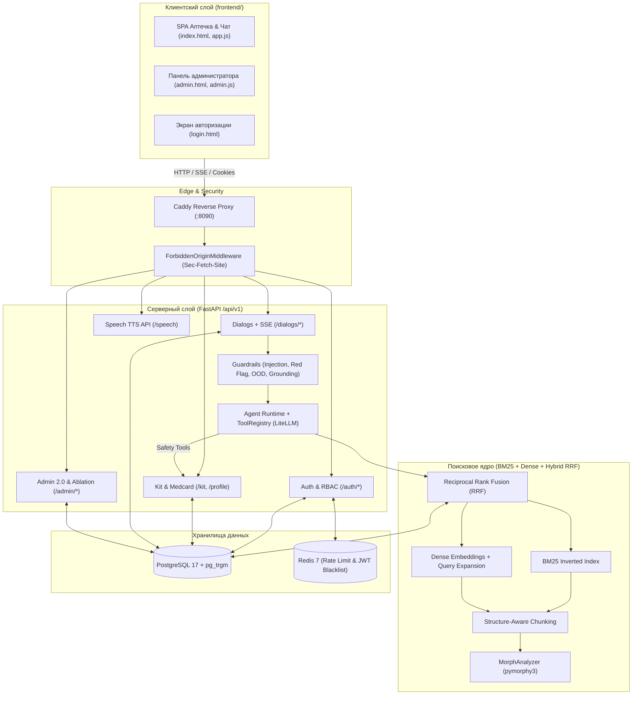

# Архитектура системы (Technical Architecture)

Архитектура MedAI объединяет React-free модульный SPA-клиент, серверный контур на FastAPI, гибридное поисковое ядро на базе PostgreSQL и Redis-контур безопасности.

---

## 1. Потоки данных (Data Flow)

### 1.1. Сквозной путь симптоматического запроса

1. **Вход и защита от атак:** Клиент отправляет `POST /api/v1/dialogs/{id}/messages` (SSE-поток) или `POST /api/v1/chat/query` (синхронный фасад с историей локальной сессии). Первый слой проверяет запрос на Prompt Injection (`detect_prompt_injection`), экстренные состояния (`is_emergency_query` — Red Flag) и нецелевой домен (`is_out_of_domain_query`).
2. **Гибридный поиск (BM25 + Dense + RRF) и приоритет аптечки:** Поисковое ядро строит леммы (`pymorphy3`), расширяет запрос медицинскими синонимами, объединяет скоринг BM25 и плотных векторов через RRF:
   $$RRF(d) = \sum_{r \in \{BM25, Dense\}} \frac{w_r}{k_r + \text{rank}_r(d)}$$
   При наличии подходящих непросроченных препаратов в аптечке пользователя они получают высший приоритет, а проверка личных конфликтов удерживает точное совпадение (например, `Парацетамол` вместо комбинированных аналогов).
3. **Агентский цикл с инструментами безопасности (`Agent` Runtime):** При наличии `LLM_API_KEY` агент получает профиль пациента, состав аптечки со сроками годности, до 20 сообщений истории и предзагруженные инструкции релевантных препаратов, а при необходимости вызывает `search_medicines`, `lookup_medicine`, `get_user_safety_context`, `check_drug_interactions`. `LiteLLMProvider` поддерживает ретраи (`num_retries = 2`) при `RateLimitError`. При отсутствии API-ключа включается детерминированный безопасный fallback.
4. **Верификация ответа и очистка вывода:** Финальный ответ проходит проверку опоры на источники (`verify_output_grounding`) и очистку от Markdown (`strip_markdown`), передается по SSE (`message_start` $\rightarrow$ `message_delta` $\rightarrow$ `message_end`) и сохраняется в PostgreSQL.

---

## 2. Режимы работы клиента (Authenticated Sync & Guest Mode)

1. Авторизованный пользователь загружает аптечку, медкарту, историю диалогов и уведомления о рассмотренных жалобах напрямую из PostgreSQL с автоматическим обновлением `access_token` через `POST /api/v1/auth/refresh`.
2. Гость работает в локальном sandbox-режиме с чистой аптечкой и медкартой через синхронный фасад `/api/v1/chat/query`.
3. Все `4xx`-ошибки отображаются явно; fallback на локальный режим активируется только при сетевых сбоях и статусах `502..504`.

---

## 3. Нефункциональные требования (NFR)

1. **Задержка поиска (Hybrid RAG Latency):** $P_{95} \le 20\text{ мс}$ на локальном корпусе.
2. **Безопасность токенов и CSRF:** `HttpOnly` cookie JWT с отзывом в Redis (`jti` blacklist), распределенный rate limiting, защита от cross-site POST/PUT/PATCH/DELETE через `Sec-Fetch-Site`.
3. **Надежность:** При падении внешнего LLM-провайдера система изолирует ошибку и не роняет HTTP-соединение.
