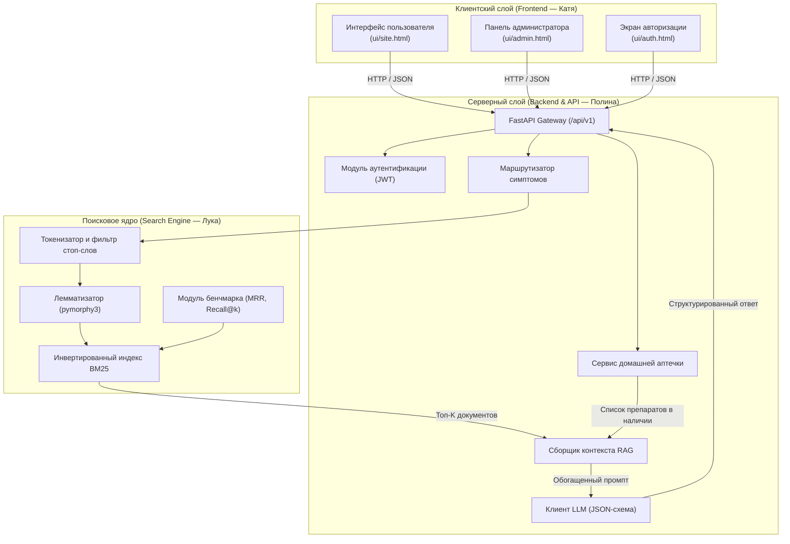

# Архитектура системы (Technical Architecture)

Архитектура MedAI разделена на три автономных слоя в соответствии с зонами ответственности команды:

---

## 1. Потоки данных (Data Flow)

### 1.1. Сквозной путь симптоматического запроса:
1. **Вход:** Фронтенд отправляет `POST /api/v1/chat/query` с текстом запроса.
2. **Маршрутизация:** Классификатор проверяет запрос на экстренные ключевые слова (`ожог`, `кровотечение`). При совпадении немедленно возвращается протокол Red Flag без обращения к поиску.
3. **BM25 Search:** Запрос токенизируется, лемматизируется в нормальные формы. Индекс рассчитывает оценки $BM25(q, d)$ и возвращает топ-3 фрагмента инструкций.
4. **Контекстная инъекция (Context Injection):** Бэкенд склеивает:
   $$\text{Промпт} = \text{Инструкция системная} + \text{Вопрос пользователя} + \text{Топ-3 инструкций BM25} + \text{Препараты в аптечке}$$
5. **Генерация и валидация:** LLM возвращает строгий JSON, который верифицируется схемой Pydantic.
6. **Выход:** Ответ с карточкой препарата, дозировкой и источником передается клиенту.

---

## 2. Архитектура Seamless Fallback (двойной режим)

Взаимодействие клиентского слоя (`ui/`) и серверного слоя (`app/`) спроектировано по принципу **Seamless Fallback**:
1. Все страницы клиентского интерфейса обращаются к единому REST API (`http://localhost:8000/api/v1`) по контрактам [docs/api.md](api.md).
2. При запущенном FastAPI-сервере Полины клиент потребляет живые данные базы PostgreSQL и инференс LLM.
3. При отсутствии ответа сервера клиент перехватывает сбой сети (`catch`) и активирует локальный демонстрационный режим на базе `localStorage` без падения страницы.

---

## 3. Нефункциональные требования (NFR)

1. **Задержка поиска (BM25 Latency):** Время ранжирования по корпусу — **до 20 мс** ($P_{95}$).
2. **Общее время ответа:** Полный цикл обработки запроса (включая LLM) — **до 2.5 с**.
3. **Автономность:** Поисковый индекс BM25 работает полностью локально без внешних сетевых вызовов.
4. **Безопасность:** Ключи API для LLM хранятся только в `.env` и никогда не коммитятся.
