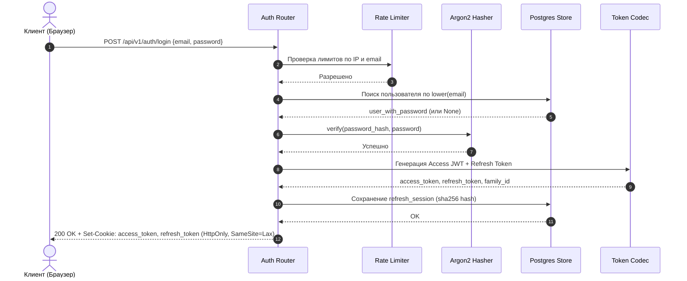

# Архитектура аутентификации и сессий (MedAI)

Спецификация подсистемы аутентификации, авторизации и управления сессиями (кафедра ИУ5 МГТУ им. Н. Э. Баумана).

---

## 1. Схема контура аутентификации

---

## 2. Инварианты безопасности

1. **Криптографическое хеширование (Argon2id):**
   - Используются параметры RFC 9106: `time_cost=3`, `memory_cost=64 MiB`, `parallelism=4`.
   - Операции хеширования выполняются в отдельном пуле потоков с семафором для предотвращения блокировки event loop.
   - Защита от тайминг-атак: при обращении с несуществующим email выполняется верификация по `dummy_hash`, что обеспечивает одинаковое время отклика сервера.
2. **Токены и Cookie:**
   - Токены доступа (JWT Access) передаются через `HttpOnly`, `SameSite=Lax` cookie.
   - Вектор атаки XSS нейтрализован: JavaScript в браузере не имеет доступа к cookie авторизации.
   - Refresh-токены хранятся в PostgreSQL исключительно в виде дайджестов SHA-256 (`token_hash LargeBinary`).
3. **Обнаружение кражи токенов (Token Family Revocation):**
   - При ротации старый refresh-токен помечается замененным (`replaced_by`).
   - Если клиент пытается повторно использовать уже замененный токен, система фиксирует попытку компрометации и каскадно аннулирует все сессии данного семейства (`family_id`).
4. **Отзыв токенов и защита от CSRF:**
   - При выходе (`POST /api/v1/auth/logout`) и смене пароля (`POST /api/v1/auth/change-password`) текущий `jti` access-токена немедленно помещается в `RedisTokenBlacklist` с TTL до конца срока действия.
   - `RedisRateLimiter` хранит распределённые счётчики неудачных попыток входа и регистраций по IP.
   - `ForbiddenOriginMiddleware` отклоняет мутирующие запросы (`POST`/`PUT`/`PATCH`/`DELETE`) с заголовком `Sec-Fetch-Site: cross-site` статусом `403`.
5. **Консольное управление (`make create-admin`):**
   - Пароль запрашивается интерактивно через `getpass` без отображения на экране и не сохраняется в истории терминала или переменных окружения.
