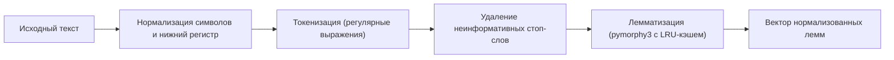
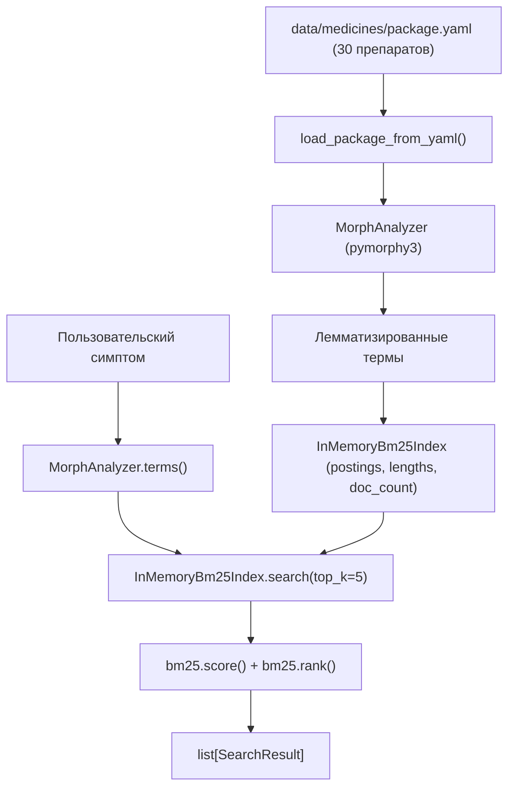

# Спецификация поисковой модели BM25

Спецификация регламентирует математический аппарат поискового алгоритма BM25 в соответствии с заданием НИРС кафедры ИУ5 МГТУ им. Н. Э. Баумана (`НИРС.pdf`), конвейер предобработки текстов и формат инвертированного индекса.

---

## 1. Математическая модель BM25

Использование сторонних поисковых библиотек запрещено заданием НИРС. Алгоритм реализуется с нуля на этапе КТ2.

### 1.1. Параметры корпуса
- $N$ — общее число документов в корпусе.
- $V = \{t_1, t_2, \dots, t_m\}$ — словарь уникальных термов.
- $|d|$ — длина документа $d$ (число термов после предобработки).
- $avgdl = \frac{1}{N} \sum_{i=1}^N |d_i|$ — средняя длина документа в корпусе.
- $TF(t, d)$ — частота терма $t$ в документе $d$.
- $DF(t)$ — число документов корпуса, содержащих терм $t$.

### 1.2. Обратная документная частота (Robertson-Spärck Jones IDF)
Согласно методическим указаниям НИРС (раздел 1.3):
$$IDF(t) = \ln \left( 1 + \frac{N - DF(t) + 0.5}{DF(t) + 0.5} \right)$$

### 1.3. Функция ранжирования BM25
Для запроса $q$, состоящего из термов $t \in q$, функция релевантности документа $d$ вычисляется как:
$$BM25(q, d) = \sum_{t \in q} IDF(t) \cdot \frac{TF(t, d) \cdot (k_1 + 1)}{TF(t, d) + k_1 \cdot \left(1 - b + b \cdot \frac{|d|}{avgdl}\right)}$$

- **$k_1 = 1.5$** — параметр насыщения частоты терма.
- **$b = 0.75$** — параметр штрафа за длину документа.

---

## 2. Конвейер предобработки текста



### 2.1. Обоснование выбора лемматизатора
- **Инструмент:** `pymorphy3` (OpenCorpora).
- **Причина выбора:** Высокая точность лемматизации русского языка с учетом падежей, чисел и глагольных форм («болит» $\rightarrow$ «болеть», «таблетками» $\rightarrow$ «таблетка»). Детерминированная работа в чистом Python без платформозависимых компилируемых C++ модулей.

---

## 3. Архитектура и программная реализация

Индекс и поисковое ядро реализованы в пакете `backend/src/medai/rag/`:

- `bm25.py` — чистая математика Robertson-Spärck Jones IDF, функция насыщения `term_score`, `score` и детерминированная сортировка `rank`.
- `analyzer.py` — нормализатор `normalize_text` (NFC, casefold, «ё» $\rightarrow$ «е»), `SimpleAnalyzer` и `MorphAnalyzer` на базе `pymorphy3` с LRU-кэшированием лемм.
- `models.py` — Pydantic v2 модели `MedicineDocument` (идентификаторы `D01`–`D30`), `MedicinePackage` и `SearchResult`.
- `index.py` — резидентный инвертированный индекс `InMemoryBm25Index` с прямым доступом и загрузчиком `load_package_from_yaml`.



Инвертированный индекс хранится в оперативной памяти в виде отображения:
```python
postings: dict[str, dict[str, int]] = {
    "голова": {"D01": 3, "D04": 2},  # term -> {doc_id: tf}
    "ибупрофен": {"D01": 5},
    "лихорадка": {"D01": 2, "D02": 3},
}
lengths: dict[str, int] = {
    "D01": 84,
    "D02": 76,
}
```
