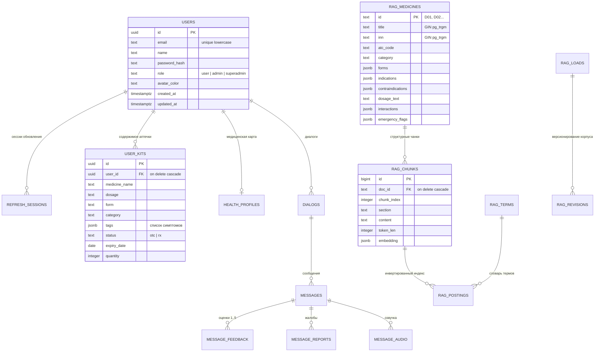

# Архитектура базы данных PostgreSQL (MedAI)

Реляционная модель данных PostgreSQL 17 с расширением `pg_trgm` для нечеткого поиска и таблицами гибридного RAG-индекса.

---

## 1. Схема сущностей и связей (ERD)



---

## 2. Миграции и наполнение

- Миграция `0001_initial_schema.py` создает базовые таблицы пользователей, аптечки, медкарты, диалогов и реестра лекарств.
- Миграция `0002_rag_hybrid_feedback_admin.py` добавляет колонку `user_kits.tags`, включает расширение `pg_trgm` с GIN-индексами по `rag_medicines.title` и `inn`, а также таблицы `rag_chunks`, `rag_terms`, `rag_postings`, `rag_stats`, `rag_loads`, `rag_revisions`, `message_feedback`, `message_reports`, `message_audio`.

```bash
make migrate
make knowledge-load DB=1
```
