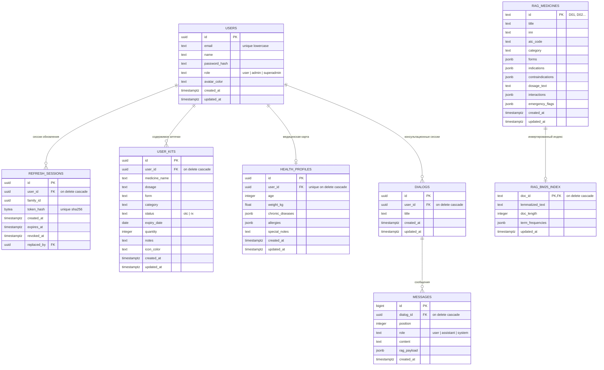

# Архитектура базы данных PostgreSQL (MedAI)

Реляционная модель данных для серверного контура умной аптечки MedAI (кафедра ИУ5 МГТУ им. Н. Э. Баумана).

---

## 1. Схема сущностей и связей (ERD)

---

## 2. Инварианты безопасности и целостности
1. **Каскадное удаление данных:** При удалении пользователя каскадно удаляются сессии, аптечка, медкарта и диалоги (`ON DELETE CASCADE`).
2. **Безопасность параметров SQL:** В модуле `engine.py` флаг `hide_parameters=True` гарантирует, что пароли и токены не попадут в текст логов или исключений при сбоях.
3. **Хранение токенов:** Токены сессий хранятся в бинарном поле `LargeBinary` в виде дайджестов SHA-256. В открытом виде токены в базе никогда не сохраняются.
4. **Контроль ролей:** Допустимые значения ролей зафиксированы констрейнтом `users_role_valid` (`user`, `admin`, `superadmin`). Роль `superadmin` обладает иммунитетом от удаления.
