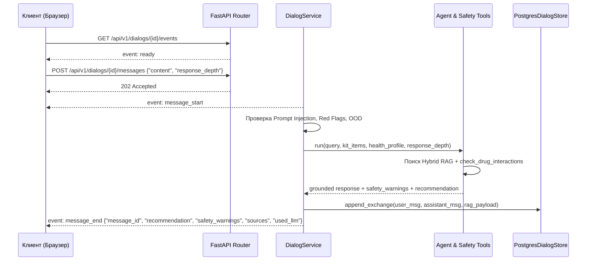

# Диалоговый слой, Agent Runtime, SSE и обратная связь

Архитектура диалогового взаимодействия MedAI объединяет потоковую передачу SSE, агентский runtime на базе LiteLLM, инструменты безопасности аптечки/медкарты и контур обратной связи.

---

## 1. Архитектура компонентов

```mermaid
flowchart TD
    Client["SPA Клиент"] -->|POST /dialogs/{id}/messages| API["FastAPI Dialog Router"]
    Client -->|GET /dialogs/{id}/events (SSE)| API

    API --> Service["DialogService"]
    Service --> Guard["Guardrails (Injection / Red Flag / OOD)"]
    Service --> Agent["Agent Runtime + LiteLLMProvider"]
    Agent --> Tools["Medical Safety Tools<br>(Аптечка + Медкарта + Дубли МНН)"]
    Agent --> Hybrid["HybridRagIndex (BM25 + Dense + RRF)"]
    Service --> History[("PostgreSQL (dialogs, messages, feedback, reports)")]
    Service --> Broker["InMemoryDialogEventBroker"]
    Broker -->|SSE Stream| Client
```

---

## 2. Жизненный цикл сообщения (Sequence)



---

## 3. Оценки, жалобы и озвучивание

- **Оценка ответа (`1..5`):** `PUT /api/v1/dialogs/{id}/messages/{msg_id}/feedback` фиксирует оценку в `message_feedback` для аналитики в Admin 2.0.
- **Жалобы и уведомления:** `POST .../report` создает тикет в `message_reports`; после модерации администратором клиент получает уведомление через `GET /api/v1/reports/news` и подтверждает прочтение (`POST /api/v1/reports/news/seen`).
- **Озвучивание (`POST .../audio` и `POST /api/v1/speech/synthesize`):** нейросетный синтез MP3 на базе `edge-tts` для 5 русских голосов (`baya`, `kseniya`, `xenia` — женские; `aidar`, `eugene` — мужские) с переключением прямо в чате; при `SPEECH_ENABLED=false` (`503`) клиентский UI прозрачно откатывается на встроенный `SpeechSynthesis`.
