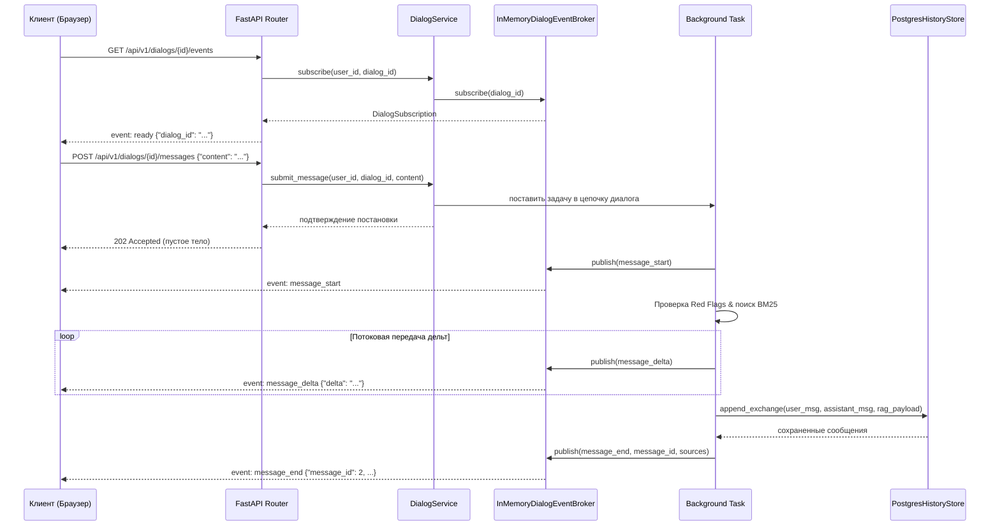

# Диалоговый слой, Event Broker и потоковая передача SSE

Архитектура диалогового взаимодействия MedAI связывает HTTP REST API с resident-движком BM25 и шиной событий в реальном времени.

---

## 1. Архитектура компонентов

```mermaid
flowchart TD
    Client["Клиент (Web UI / Mobile)"] -->|POST /dialogs| API["FastAPI Dialog Router"]
    Client -->|GET /dialogs/{id}/events (SSE)| API
    Client -->|POST 202 /dialogs/{id}/messages| API
    Client -->|POST /chat/query (sync)| API

    API --> Service["DialogService"]
    Service --> History[("PostgresHistoryStore<br>(dialogs, messages)")]
    Service --> Broker["InMemoryDialogEventBroker<br>(очереди 64 события)"]
    Service --> BM25["InMemoryBm25Index (data/medicines)"]
    Service --> Tasks["Фоновая цепочка задач<br>(asyncio.Task per dialog)"]

    Tasks -->|message_start| Broker
    Tasks -->|BM25 Search & Synthesis| BM25
    Tasks -->|message_delta chunks| Broker
    Tasks -->|atomic append| History
    Tasks -->|message_end| Broker
    Broker -->|SSE Stream| Client
```

---

## 2. Жизненный цикл сообщения (Sequence)



---

## 3. Спецификация событий SSE

| Тип события | Полезная нагрузка (`data`) | Назначение |
|---|---|---|
| `ready` | `{"dialog_id": "uuid"}` | Подтверждение установления SSE-соединения |
| `message_start` | `{}` | Старт синтеза ответа ассистента |
| `message_delta` | `{"delta": "строка"}` | Инкрементальный текстовый фрагмент ответа |
| `message_end` | `{"message_id": int, "emergency_mode": bool, "sources": [...]}` | Завершение ответа с метаданными RAG |
| `message_error` | `{"code": "internal_error", "message": "текст"}` | Уведомление о сбое генерации |
| `keep-alive` | `: keep-alive` (SSE comment) | Пинг каждые 10 секунд при простое |

---

## 4. Контракты эндпоинтов

- `POST /api/v1/dialogs` — создание нового диалога (`201 Created`, заголовок `Location: /api/v1/dialogs/{id}`).
- `GET /api/v1/dialogs` — список диалогов пользователя с сортировкой по `updated_at` desc.
- `GET /api/v1/dialogs/{id}/messages` — полная стенограмма сообщений диалога (`200 OK`).
- `DELETE /api/v1/dialogs/{id}` — удаление диалога и закрытие брокера (`204 No Content`).
- `POST /api/v1/dialogs/{id}/messages` — постановка запроса в фоновую очередь (`202 Accepted`).
- `GET /api/v1/dialogs/{id}/events` — потоковая передача (`text/event-stream`).
- `POST /api/v1/chat/query` — синхронный JSON-фасад RAG для совместимости с фронтендом.
