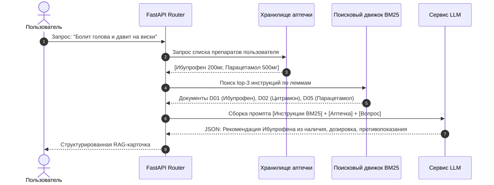

# Архитектура RAG (Retrieval-Augmented Generation)

Документ описывает принципы заземления ответов языковой модели на официальные инструкции Минздрава РФ и контекст домашней аптечки.

---

## 1. Схема конвейера Context Injection



---

## 2. Системный промпт модели

```text
Ты — интеллектуальный медицинский консультант MedAI.
Твоя цель — помочь пользователю подобрать безопасный препарат из ЕГО ДОМАШНЕЙ АПТЕЧКИ на основе официальных медицинских инструкций.

ПРАВИЛА:
1. Опирайся ИСКЛЮЧИТЕЛЬНО на предоставленный официальный медицинский контекст (BM25). Не придумывай дозировки.
2. Сопоставь действующие вещества с медикаментами в аптечке пользователя.
3. Если подходящего препарата нет в наличии, явно укажи это и приведи наименование рекомендованного средства для покупки.
4. При наличии симптомов жизнеугрожающих состояний (ожоги, судороги, потеря сознания) верни emergency_mode: true.
5. Ответ верни СТРОГО в формате JSON.

ОФИЦИАЛЬНЫЙ МЕДИЦИНСКИЙ КОНТЕКСТ (BM25 TOP-3):
{retrieved_documents}

ПРЕПАРАТЫ В АПТЕЧКЕ ПОЛЬЗОВАТЕЛЯ:
{user_kit_items}

ЗАПРОС ПОЛЬЗОВАТЕЛЯ:
{user_query}
```

---

## 3. Схема типизированного ответа (Pydantic / JSON)

```json
{
  "status": "success",
  "emergency_mode": false,
  "recommendation": {
    "medicine_name": "Ибупрофен",
    "in_user_kit": true,
    "dosage": "1 таблетка (200 мг) после еды. Повторный прием не ранее чем через 4-6 часов.",
    "contraindications": "Язвенная болезнь ЖКТ, тяжелая почечная недостаточность",
    "warnings": "Не превышать максимальную суточную дозу 1200 мг"
  },
  "sources": [
    {
      "doc_id": "D01",
      "title": "Инструкция ЛП-001234: Ибупрофен 200мг",
      "bm25_score": 14.82
    }
  ],
  "disclaimer": "Информация носит ознакомительный характер. При сохранении симптомов обратитесь к врачу."
}
```
