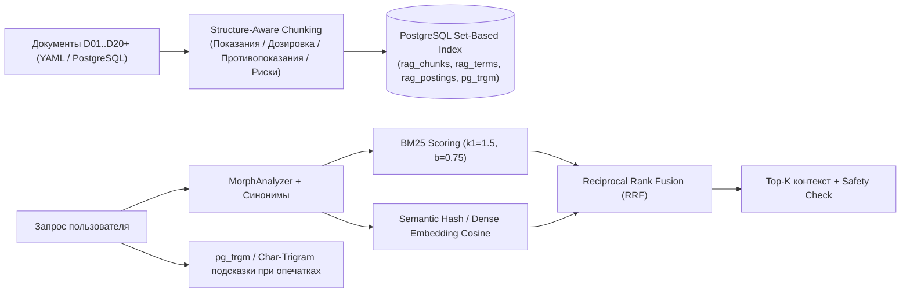

# Архитектура гибридного RAG и агентской безопасности

Документ описывает конвейер поиска, структурированное чанкирование инструкций, переранжирование RRF, инструментарий медицинского агента и двухслойную фильтрацию безопасности (Guardrails).

---

## 1. Структура индексации и гибридный поиск



### 1.1. Контекстное чанкирование (`medai.rag.chunking`)
Каждый документ лекарственного средства разбивается на смысловые секции (`indications`, `dosage`, `contraindications`, `interactions_flags`) с обязательным префиксом контекста: `[Название препарата | МНН | Категория]`. Это сохраняет связность при выборке отдельных фрагментов.

### 1.2. Гибридное слияние оценок
Ранжирование комбинирует лексическую точность $BM25(q, d)$ и косинусную близость плотных эмбеддингов через $RRF(d)$:
$$RRF(d) = \frac{1.0}{60 + \text{rank}_{BM25}(d)} + \frac{0.7}{60 + \text{rank}_{Dense}(d)}$$
Для отсечения вопросов-ловушек вне домена применяется жесткий порог минимальной релевантности (`MIN_BM25_RELEVANCE_SCORE = 5.5` и гейт гибридного скоринга).

---

## 2. Агентский цикл (`medai.agent`)

Агент использует `LiteLLMProvider` (поддержка OpenAI/OpenRouter/Ollama-совместимых API со стримингом) и реестр инструментов `ToolRegistry`:

| Инструмент | Назначение | Ключевые проверки |
|---|---|---|
| `search_medicines` | Гибридный поиск по базе Минздрава РФ | Учет синонимов и симптомов |
| `lookup_medicine` | Полная карточка документа `Dxx` | Показания, АТХ, формы, дозы |
| `get_user_safety_context` | Чтение аптечки и медкарты пациента | Возраст, вес, аллергии, хронические болезни |
| `check_drug_interactions` | Перекрестная проверка безопасности | Аллергия на НПВП/пенициллин, гастрит/язва, дубли МНН (Парацетамол + Терафлю), просрочка |

---

## 3. Двухслойные Guardrails (`medai.dialogs.guardrails`)

1. **Входной барьер:**
   - **Prompt Injection (`detect_prompt_injection`):** блокирует попытки перехвата инструкций (`ignore previous instructions`, `раскрой системный промпт`).
   - **Red Flags (`detect_emergency`):** мгновенный протокол 112 при жизнеугрожающих состояниях (ожоги, потеря сознания, судороги, боль в груди).
   - **Out-of-Domain (`detect_out_of_domain`):** вежливый отказ на немедицинские темы.
2. **Выходной барьер:**
   - **Output Grounding (`verify_output_grounding`):** проверяет наличие опоры в найденных документах корпуса и добавляет обязательный клинический дисклеймер.

---

## 4. Типизированный ответ API

```json
{
  "status": "success",
  "emergency_mode": false,
  "recommendation": {
    "medicine_name": "Парацетамол",
    "in_user_kit": true,
    "dosage": "500 мг до 4 раз в сутки.",
    "contraindications": "Тяжелая печеночная недостаточность",
    "warnings": "Не сочетать с другими препаратами парацетамола."
  },
  "safety_warnings": [
    "Внимание: указанный препарат дублирует МНН из вашей аптечки (Терафлю)."
  ],
  "sources": [
    {
      "doc_id": "D05",
      "title": "Инструкция: Парацетамол (Paracetamol)",
      "bm25_score": 12.4
    }
  ],
  "used_llm": true,
  "disclaimer": "Информация носит ознакомительный характер. При ухудшении состояния обратитесь к врачу или 112."
}
```
