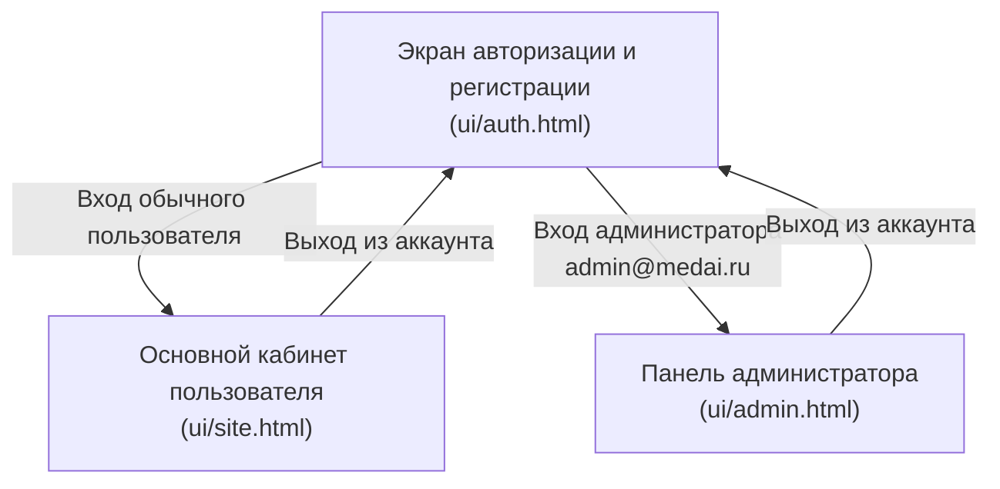
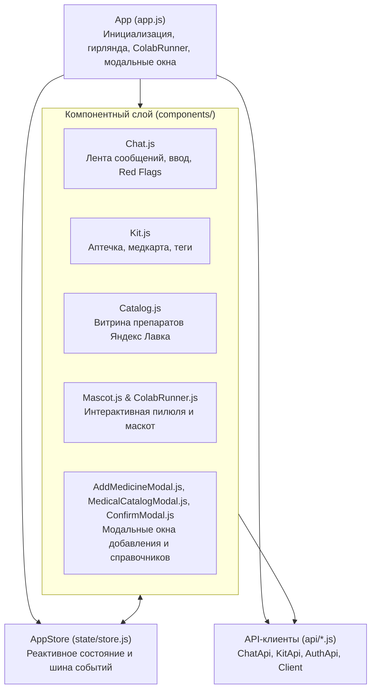

# Спецификация пользовательского интерфейса (UI/UX)

Документ описывает структуру, компоненты, визуальные токены и логику взаимодействия пользовательского интерфейса MedAI на основе утвержденных макетов Каты ([ui/auth.html](../../ui/auth.html), [ui/site.html](../../ui/site.html), [ui/admin.html](../../ui/admin.html)).

---

## 1. Карта экранов

---

## 2. Дизайн-система (Design Tokens)

Интерфейс оформлен в чистой медицинской стилистике с доминантой изумрудного зеленого цвета:

| CSS-токен | Значение HEX | Назначение |
|---|---|---|
| `--green` | `#019F74` | Основной акцентный цвет (кнопки, активные чипсы, аватары) |
| `--green-dark` | `#017a5a` | Цвет кнопок при наведении (Hover) |
| `--green-light` | `#e6f7f2` | Фон выбранных элементов и чипсов лекарств |
| `--bg-chat` | `#f0f1f3` | Фоновый цвет контейнера сообщений |
| `--bg-pattern` | `#f7f9fa` | Фоновый цвет страниц с фоновой текстурой капсул |
| `--card` | `#ffffff` | Фон карточек, модальных окон и сообщений бота |
| `--text` | `#1a1a1a` | Основной цвет заголовков и текста |
| `--text-muted` | `#7a7f85` | Пояснительный текст, плейсхолдеры, вторичные метки |
| `--border` | `#e5e7eb` | Разделители, границы полей ввода и карточек |
| `--danger` | `#e5484d` | Ошибки валидации, кнопки удаления, баннер Red Flags |

---

## 3. Инвариант авторства интерфейса

Дизайн Каты является утвержденным стандартом визуальной системы MedAI. Все новые фичи интерфейса (каталог быстрого добавления, мультичат, профиль здоровья) разрабатываются в согласованной ветке интерфейса и интегрируются без нарушения установленной цветовой гаммы и компоновки.

---

## 4. Модульная архитектура клиентского приложения (каталог `frontend/`)

Для масштабирования интерфейса и интеграции динамических сценариев в ветке `feat/ui-redesign` развернута SPA-архитектура на ES-модулях:

### Ключевые компоненты:
1. **`Chat.js` & `Mascot.js`:** центральная рабочая область с симметричным Gemini-style хедером, карточками RAG-ответов, экстренным вызовом 112 при Red Flags и анимированным маскотом с шапочкой Санты.
2. **`Kit.js` & `AddMedicineModal.js`:** домашняя аптечка с кнопкой добавления пользовательского препарата над поиском, быстрым выбором, управлением медкартой (ползунки веса и возраста) и карточками особых примечаний.
3. **`Catalog.js`:** витрина лекарств с каруселью категорий, поиском и анимацией полета таблеток в аптечку по кривой Безье.
4. **`MedicalCatalogModal.js`:** модальный справочник аллергий и непереносимостей с категорийной фильтрацией и вводом своих вариантов.
5. **`ConfirmModal.js`:** безопасный асинхронный диалог подтверждения удаления без блокирующего `window.confirm`.

