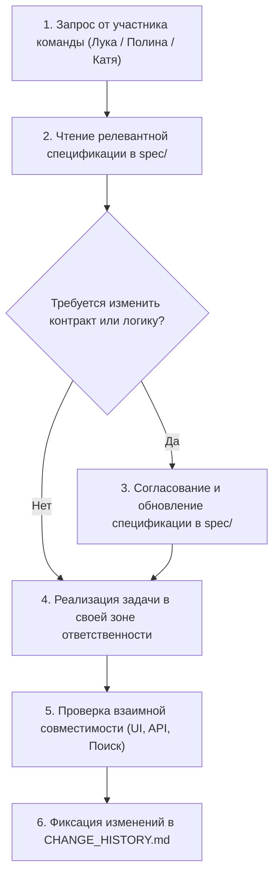

# AGENTS.md — Проектный регламент для AI-агентов команды MedAI

Данный документ определяет распределение ролей, зон ответственности и специфику работы AI-ассистентов в проекте **MedAI**.  
Базовые правила безопасности, режим выполнения и методология разработки зафиксированы в [GEMINI.md](GEMINI.md).

---

## 1. Роли в команде и зоны ответственности

Проект разрабатывается командой из трех человек. AI-ассистент обязан адаптироваться под контекст текущего разработчика:

| Разработчик | Роль в проекте | Зона ответственности и закрепленные файлы |
| :--- | :--- | :--- |
| **Лука (Тимлид)** | Архитектура, BM25, бенчмаркинг | `spec/tech/rag.md`, `spec/tech/benchmark.md`, модуль поискового индекса BM25, токенизация, лемматизация, оценка качества ($MRR$, $Recall@k$). |
| **Полина** | Бэкенд, серверные контракты | `spec/tech/api.md`, `spec/tech/architecture.md`, серверный слой FastAPI, Pydantic-схемы, валидация данных аптечки. |
| **Катя** | Фронтенд, UI/UX интерфейс | `spec/product/ui_spec.md`, макеты интерфейса `ui/auth.html` и `ui/site.html`, клиентские скрипты и стили. |

---

## 2. Специфические проектные правила

1. **Неприкосновенность утвержденного дизайна:**
   - Интерфейс разработан Катей в файлах `ui/auth.html` и `ui/site.html`.
   - Запрещено менять концепцию, самовольно переделывать стили или заменять файлы на сторонние макеты. Документация в `spec/product/ui_spec.md` строго описывает этот интерфейс.
2. **Уважение к наработкам коллег:**
   - Работая над задачами одного участника, агент не должен ломать контракты и наработки других (бэкенд строится строго под контракты и интерфейс, согласованные с фронтендом).
3. **Соблюдение границ текущего этапа:**
   - Агент реализует только то, что входит в текущую задачу, поставленную разработчиком (без забегания вперед и преждевременной генерации не запрошенных модулей).

---

## 3. Рабочий цикл агента в проекте

