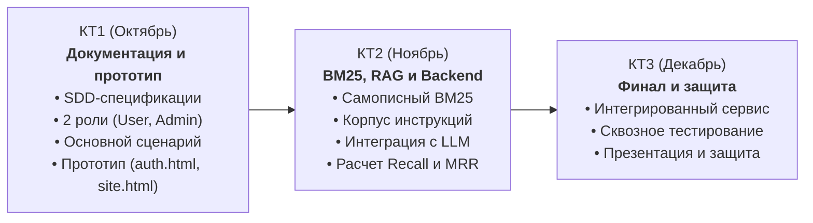

# MedAI — Умная домашняя аптечка

Интеллектуальный веб-сервис персональной инвентаризации домашней аптечки и безопасного подбора средств доврачебной помощи на базе алгоритма **BM25** и **LLM**.

Проект разрабатывается в рамках научно-исследовательской работы студентов (НИРС 2026, МГТУ им. Н. Э. Баумана).  
Дисциплина: *Разработка RAG-приложения с помощью LLM*.  
Преподаватель: *Кирибаев Т. Е.*

---

## 1. Концепция и решаемая задача

В домашних аптечках скапливаются десятки медикаментов без упаковок и инструкций. При возникновении симптомов (головная боль, порез, спазм, простуда) человек рискует принять несовместимые препараты или превысить допустимую дозировку. Универсальные языковые модели без верифицированного контекста галлюцинируют в дозировках и не учитывают наличие препаратов у конкретного пользователя.

**Архитектурное решение MedAI:**
1. **Детерминированный поиск (BM25):** поисковый индекс выполняет поиск только по верифицированной базе официальных инструкций Минздрава РФ.
2. **Учет домашнего инвентаря:** система сопоставляет найденные вещества с медикаментами, добавленными в домашнюю аптечку пользователя.
3. **Безопасная генерация (LLM):** языковая модель получает фрагмент официальной инструкции и список препаратов в наличии, формируя структурированный ответ с точной дозировкой, противопоказаниями и предупреждениями.

> **Дисклеймер:** Сервис носит информационно-справочный характер, не ставит медицинских диагнозов и при угрожающих состояниях рекомендует немедленно обратиться к врачу или вызвать скорую медицинскую помощь по номеру 112.

---

## 2. Состав команды и зоны ответственности

| Участник | Роль в проекте | Основная зона ответственности |
|---|---|---|
| **Лука (Тимлид)** | RAG, BM25 & Data | Поисковый алгоритм BM25, токенизация и лемматизация, сбор корпуса инструкций, проведение бенчмаркинга (Recall@k, MRR), архитектура SDD |
| **Полина** | Backend & API | Проектирование REST API, бизнес-логика инвентаризации аптечки, интеграция с LLM, валидация JSON-схем, маршрутизация запросов |
| **Катя** | Frontend & UI/UX | Проектирование пользовательского опыта, разработка интерфейса (`ui/auth.html`, `ui/site.html`), дизайн-система и клиентская логика |

---

## 3. Статус: Контрольная Точка 1 (КТ1)

На этапе Контрольной Точки 1 подготовлен полный комплект документации по методологии **Spec-Driven Development (SDD)** и прототип интерфейса:

- [x] Определена тема и сформировано техническое описание задачи.
- [x] Описаны 2 типа пользователей: **Пользователь** (`User`) и **Администратор** (`Admin`).
- [x] Формализован **основной сценарий** («Подбор лекарства из наличия при острой боли»).
- [x] Предоставлен рабочий прототип интерфейса от Кати ([ui/auth.html](ui/auth.html), [ui/site.html](ui/site.html)).
- [x] Разработана детальная спецификация интерфейса [spec/product/ui_spec.md](spec/product/ui_spec.md).
- [x] Сформированы технические спецификации: архитектура, поисковый движок BM25, бенчмарк и API.
- [x] Серверный код и работающий RAG на данном этапе отсутствуют (реализация стартует на КТ2).

---

## 4. Запуск прототипа интерфейса

Интерфейс представляет собой клиентское веб-приложение, не требующее внешних библиотек и сборщиков.

### Вариант 1. Прямое открытие в браузере
- Экран входа и регистрации: [ui/auth.html](ui/auth.html)
- Основной интерфейс аптечки и диалога: [ui/site.html](ui/site.html)

### Вариант 2. Локальный статический сервер
```bash
python3 -m http.server 8000
```
Открыть в браузере: `http://localhost:8000/ui/auth.html`

---

## 5. Карта документации SDD

Все ссылки внутри репозитория строго относительные:

### Регламенты разработки
- [AGENTS.md](AGENTS.md) — единые правила работы AI-ассистентов с кодовой базой и документацией.
- [CHANGE_HISTORY.md](CHANGE_HISTORY.md) — журнал версий репозитория.
- [GEMINI.md](GEMINI.md) — системные правила и ограничения для AI-ассистентов.

### Продуктовые спецификации (`spec/product/`)
- [spec/product/product.md](spec/product/product.md) — концепция сервиса, цели, границы системы, стратегия 20/80.
- [spec/product/roles.md](spec/product/roles.md) — роли User и Admin, персоны, матрица прав доступа (RBAC).
- [spec/product/scenarios.md](spec/product/scenarios.md) — основной сценарий, инвентаризация, чекер совместимости, экстренный протокол.
- [spec/product/ui_spec.md](spec/product/ui_spec.md) — спецификация интерфейса, дизайн-система, описание экранов `auth.html` и `site.html`.

### Технические спецификации (`spec/tech/`)
- [spec/tech/architecture.md](spec/tech/architecture.md) — компонентная архитектура системы, схема потоков данных.
- [spec/tech/rag.md](spec/tech/rag.md) — математический аппарат BM25, токенизация, лемматизация, Context Injection.
- [spec/tech/benchmark.md](spec/tech/benchmark.md) — метрики качества поиска (Recall@k, MRR), golden dataset.
- [spec/tech/api.md](spec/tech/api.md) — спецификация контрактов REST API (JSON Schemas).

---

## 6. Дорожная карта проекта


