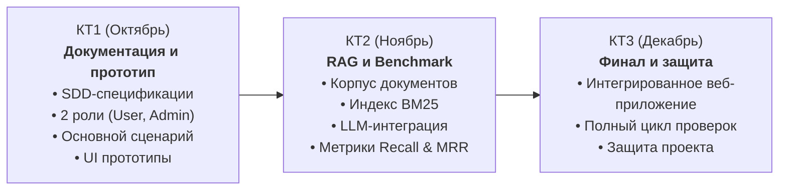

# MedAI — Умная домашняя аптечка

**Научно-исследовательская работа студентов (НИРС 2026)**  
Кафедра ИУ / МГТУ им. Н. Э. Баумана  
Дисциплина: *Разработка RAG-приложения с помощью LLM*  
Преподаватель: *Кирибаев Тимур Ербулович*

---

## 1. О проекте
**MedAI** — это интеллектуальный веб-сервис для персональной инвентаризации домашней аптечки и безопасного подбора средств первой доврачебной помощи. 

В основе решения лежит связка:
1. **Самописный поисковый движок BM25** — осуществляет детерминированный информационный поиск релевантных медицинских инструкций и протоколов доврачебной помощи по локальному корпусу проверенных медицинских документов.
2. **Контекстная инъекция (Context Injection) и LLM** — формирует персонализированный, структурированный и понятный ответ для пользователя, строго учитывая состав его персональной аптечки, противопоказания и правила первой помощи.

> **Медицинский дисклеймер:** Сервис носит информационный и вспомогательный характер, не ставит медицинских диагнозов и не отменяет необходимости обращения к квалифицированному врачу или в службу скорой помощи (112).

---

## 2. Команда и распределение ролей

В соответствии с требованиями НИРС команда состоит из 3 человек с постоянными зонами ответственности:

| Участник | Роль в проекте | Основная зона ответственности |
|---|---|---|
| **Тимлид** | RAG, BM25 & Data | Разработка и оптимизация поискового движка BM25, сбор и очистка корпуса медицинских инструкций, токенизация/лемматизация, проведение бенчмаркинга (Recall@k, MRR), архитектура SDD |
| **Полина** | Backend & API | Проектирование REST API, бизнес-логика инвентаризации аптечки, модуль интеграции с LLM, валидация JSON-ответов, маршрутизация запросов |
| **Катя** | Frontend & UI/UX | Проектирование интерфейса, пользовательский опыт (UX), верстка адаптивного интерфейса (личный кабинет, чат с ассистентом, панель администратора) |

Каждый участник понимает сквозной путь запроса в системе и может запустить проект локально.

---

## 3. Статус: Контрольная Точка 1 (КТ1)

На этапе Контрольной Точки 1 проект подготовлен строго по методологии **Spec-Driven Development (SDD)**:
- [x] Определена тема и сформировано ценностное предложение.
- [x] Спроектированы **два типа пользователей**: обычный пользователь (**User**) и администратор корпуса знаний (**Admin**).
- [x] Детально описан **основной сценарий** («Подбор лекарства из наличия при острой боли»).
- [x] Разработана интерактивная статическая модель интерфейса (прототипы экранов входа, личного кабинета с чатом и панели администратора).
- [x] Сформирована исчерпывающая структура документации SDD (`spec/product/`, `spec/tech/`).
- [x] Согласно регламенту КТ1, в репозитории **отсутствует** исполняемый бэкенд-код и боевые алгоритмы (реализация стартует на этапе КТ2).

---

## 4. Быстрый запуск прототипа интерфейса

Прототип представляет собой набор статических HTML5/CSS3/JS файлов без внешних зависимостей.

### Вариант 1. Прямое открытие в браузере
Достаточно открыть файлы двойным кликом или через браузер:
- Экран входа и регистрации: [`ui/auth.html`](file:///Users/lukacobotov/nirs_sandbbox/sandbox/ui/auth.html)
- Основное приложение (Пользователь): [`ui/app.html`](file:///Users/lukacobotov/nirs_sandbbox/sandbox/ui/app.html)
- Панель администратора: [`ui/admin.html`](file:///Users/lukacobotov/nirs_sandbbox/sandbox/ui/admin.html)

### Вариант 2. Локальный статический сервер
Из папки `sandbox/`:
```bash
python3 -m http.server 8000
```
После запуска перейти по адресу:
- `http://localhost:8000/ui/auth.html`

---

## 5. Навигация по SDD-документации

Проект документирован в соответствии с методологией Spec-Driven Development:

### Корневые регламенты
- [`AGENTS.md`](file:///Users/lukacobotov/nirs_sandbbox/sandbox/AGENTS.md) — единые правила работы AI-агентов с репозиторием.
- [`CHANGE_HISTORY.md`](file:///Users/lukacobotov/nirs_sandbbox/sandbox/CHANGE_HISTORY.md) — журнал версий и история изменений.

### Продуктовые спецификации (`spec/product/`)
- [`product.md`](file:///Users/lukacobotov/nirs_sandbbox/sandbox/spec/product/product.md) — видение продукта, цели, границы системы, стратегия 20/80.
- [`roles.md`](file:///Users/lukacobotov/nirs_sandbbox/sandbox/spec/product/roles.md) — спецификация ролей пользователей (User и Admin), матрица прав доступа.
- [`scenarios.md`](file:///Users/lukacobotov/nirs_sandbbox/sandbox/spec/product/scenarios.md) — основной сценарий, альтернативные кейсы и экстренный протокол.
- [`ui_spec.md`](file:///Users/lukacobotov/nirs_sandbbox/sandbox/spec/product/ui_spec.md) — спецификация интерфейсов, карта экранов, UX-потоки.

### Технические спецификации (`spec/tech/`)
- [`architecture.md`](file:///Users/lukacobotov/nirs_sandbbox/sandbox/spec/tech/architecture.md) — верхнеуровневая архитектура системы, схема компонентов и поток данных.
- [`rag.md`](file:///Users/lukacobotov/nirs_sandbbox/sandbox/spec/tech/rag.md) — математическое описание алгоритма BM25, токенизация, лемматизация, Context Injection.
- [`benchmark.md`](file:///Users/lukacobotov/nirs_sandbbox/sandbox/spec/tech/benchmark.md) — методология оценки качества поиска (Recall@k, MRR), структура тестового набора.
- [`api.md`](file:///Users/lukacobotov/nirs_sandbbox/sandbox/spec/tech/api.md) — контракты REST API и структуры схем данных.

---

## 6. Дорожная карта проекта


