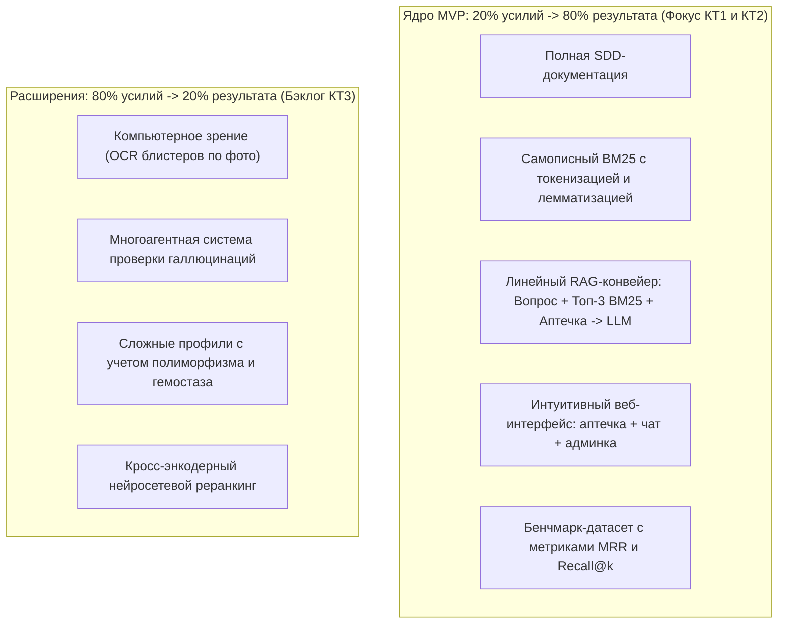

# Продуктовая спецификация: MedAI (Умная домашняя аптечка)

## 1. Проблематика и контекст

В среднестатистической домашней аптечке накапливаются десятки препаратов: блистеры без коробок, начатые упаковки, мази с выцветшим текстом. При возникновении острой симптоматики (головная боль, порез, расстройство желудка, температура) человек сталкивается со следующими проблемами:
1. **Информационный шум и нечитаемые инструкции:** Официальные аннотации к лекарствам содержат сложную медицинскую терминологию мелким шрифтом, которую трудно оперативно проанализировать при плохом самочувствии.
2. **Риск несовместимости и передозировки:** Прием нескольких препаратов от простуды (например, порошка Терафлю и таблеток Парацетамола) часто приводит к опасной передозировке одним и тем же действующим веществом.
3. **Бесполезные советы из интернета:** Поисковые системы часто ведут на сомнительные форумы, а универсальные LLM склонны галлюцинировать при прямых медицинских вопросах без опоры на проверенную документацию.
4. **Неведение о наличии:** Человек заказывает доставку или идет в аптеку, хотя подходящее действующее вещество уже лежит в домашней аптечке под другим торговым наименованием (например, «Ибупрофен» вместо «Нурофена»).

---

## 2. Видение продукта (Product Vision)

**MedAI** — это персональный веб-ассистент, объединяющий учет домашней аптечки, детерминированный поиск по официальным медицинским инструкциям Минздрава РФ с помощью поискового алгоритма **BM25**, и генерацию понятных рекомендаций на естественном языке с помощью **LLM**.

### Ключевые принципы:
- **Опора на факты (Grounded QA):** Модель отвечает строго по найденным через BM25 официальным инструкциям. Если подтвержденной информации нет, ассистент прямо сообщает об этом.
- **Персонализация по наличию:** Рекомендация строится в первую очередь из того, что пользователь физически добавил в свою аптечку.
- **Безопасность прежде всего:** Обязательный контроль противопоказаний, дозировок и выделение симптомов, требующих неотложной медицинской помощи.

---

## 3. Целевая аудитория и стейкхолдеры

1. **Владельцы домашних аптечек (Пользователи):**
   - Семьи с детьми, которым важно быстро проверить допустимость препарата по возрасту и температуре.
   - Пожилые люди или люди с регулярным приемом медикаментов, нуждающиеся в контроле совместимости.
   - Занятые городские жители, которым нужна оперативная доврачебная подсказка при типовых недомоганиях.
2. **Администраторы и эксперты системы (Администраторы):**
   - Члены команды проекта, ответственные за актуальность и чистоту корпуса медицинских инструкций.
   - Специалисты, отслеживающие метрики поисковой точности (Recall@k, MRR) и исключающие некорректные источники.
3. **Учебная комиссия / Преподаватель (Стейкхолдер):**
   - Оценка корректности математического аппарата BM25, соблюдения методологии SDD и работоспособности интерфейса.

---

## 4. Стратегия реализации 20/80 (Принцип Парето)

В соответствии с методическими рекомендациями курса, проект разделен на ядро (20% усилий, дающих 80% ценности для защиты) и расширенный бэклог.

### Скоуп Контрольной Точки 1 (КТ1):
- Полностью согласованная документация SDD.
- Утвержденные роли: Пользователь и Администратор.
- Спроектированный основной сценарий и экстренный протокол.
- Интерактивный статический прототип UI без функционального бэкенда.

---

## 5. Границы системы и ограничения

1. **Не является средством постановки диагноза:** Приложение позиционируется как справочно-информационный ассистент по инструкциям.
2. **Экстренные ситуации:** При детекции ключевых слов высокого риска («кровотечение», «потеря сознания», «анафилаксия», «острая боль в сердце») интерфейс системы переключается в тревожный режим, блокируя стандартные советы и выводя телефон экстренных служб (`112`).
3. **Локальный корпус данных:** Поиск BM25 ограничен базой верифицированных инструкций препаратов, загруженных в систему администратором.
