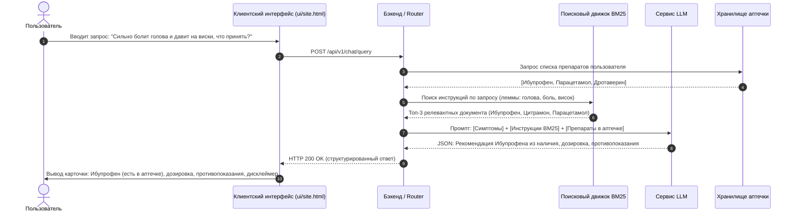

# Сценарии взаимодействия (Use Cases)

Документ описывает основной и вспомогательные сценарии работы с системой **MedAI**.

---

## 1. Основной сценарий (Primary Use Case): Подбор препарата из аптечки при острой боли

- **ID:** `UC-01`
- **Актор:** Пользователь (`User`).
- **Предусловие:** Пользователь авторизован в системе. В боковой панели «Домашняя аптечка» добавлены препараты: *Ибупрофен*, *Парацетамол*, *Дротаверин*. Корпус официальных медицинских инструкций проиндексирован поисковым модулем BM25.

### 1.1. Диаграмма последовательности основного сценария

### 1.2. Пошаговое выполнение сценария:
1. **Ввод симптомов:** Пользователь открывает интерфейс `site.html`, нажимает на поле ввода диалога и пишет сообщение: «Сильно болит голова и давит на виски, что принять?».
2. **Токенизация и лемматизация (BM25):** Поисковое ядро выполняет нормализацию текста запроса, исключает стоп-слова и приводит словоформы к нормальному виду (`болеть`, `голова`, `давить`, `висок`).
3. **Поисковое ранжирование:** Алгоритм BM25 рассчитывает оценки соответствия по инвертированному индексу официальных инструкций Минздрава РФ. В топ выдачи попадает инструкция к *Ибупрофену*.
4. **Контекстное сопоставление (Context Injection):** Бэкенд проверяет пересечение найденных активных веществ со списком медикаментов в аптечке пользователя. Находится совпадение: *Ибупрофен* присутствует в наличии.
5. **Генерация ответа (LLM):** Языковая модель формирует структурированный ответ, цитируя официальный режим дозирования (1 таблетка 200 мг после еды, повторно не ранее чем через 4–6 часов) и список ключевых противопоказаний.
6. **Вывод на экран:** Пользователь видит ответ ассистента с подтверждением наличия препарата в домашней аптечке и обязательным медицинским дисклеймером.

---

## 2. Вспомогательные пользовательские сценарии

### 2.1. Сценарий: Инвентаризация домашней аптечки (`UC-02`)
1. Пользователь нажимает кнопку открытия аптечки на боковом рейле.
2. В выдвижной панели нажимает «Добавить лекарство».
3. В модальном окне вводит наименование медикамента (например, «Амоксициллин») и сохраняет форму.
4. Препарат появляется в списке медикаментов аптечки и начинает учитываться поисковым модулем при анализе симптомов.

### 2.2. Сценарий: Контроль фармакологической совместимости (`UC-03`)
1. Пользователь выбирает в аптечке препараты *Парацетамол* и *Аспирин* (чипсы медикаментов закрепляются в поле ввода) и отправляет запрос: «Можно ли принять эти препараты одновременно?».
2. Система анализирует официальные инструкции обоих средств и проверяет фармакологическое взаимодействие.
3. Ассистент выводит предупреждение о недопустимости одновременного приема из-за повышения риска эрозивно-язвенных поражений ЖКТ и рекомендует интервал между приемами.

### 2.3. Сценарий: Экстренный протокол доврачебной помощи (`UC-04`)
1. Пользователь вводит запрос, содержащий ключевые слова экстренного состояния: «Сильный термический ожог кипятком, слезла кожа».
2. Классификатор запросов мгновенно активирует режим неотложной помощи:
   - Блокируются стандартные рекомендации таблеток.
   - Выводится прямой номер службы экстренной помощи (112).
   - Пошагово выводятся правила первой доврачебной помощи: немедленное охлаждение проточной водой в течение 15 минут, наложение сухой стерильной повязки, запрет на использование масел и спиртовых растворов.

---

## 3. Сценарий Администратора: Управление базой инструкций (`UC-05`)

1. Администратор авторизуется в системе и переходит к операциям управления корпусом.
2. Отправляет запрос на добавление новой медицинской инструкции (МНН, торговое наименование, структурированный текст показаний и противопоказаний).
3. Инициализирует переиндексацию корпуса поисковым движком BM25.
4. Запускает автоматизированный прогон 45 эталонных запросов для подтверждения качества ранжирования (метрики $MRR \ge 0.70$, $Recall@3 \ge 0.85$).
