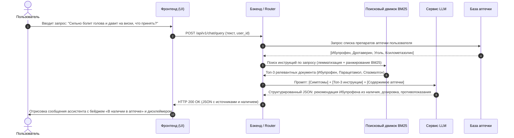

# Сценарии взаимодействия (Use Cases & Scenarios)

В данном документе формализованы основной и вспомогательные сценарии взаимодействия пользователей с системой **MedAI**.

---

## 1. Основной сценарий (Primary Use Case): Подбор лекарства при острой симптоматике с учетом наличия

### 1.1. Карточка сценария
- **ID:** `UC-01`
- **Название:** Интеллектуальный подбор препарата из домашней аптечки по описанию симптомов.
- **Главный актор:** Пользователь (User).
- **Предусловия:** 
  1. Пользователь авторизован в системе.
  2. В домашней аптечке пользователя добавлены препараты: *Ибупрофен (200 мг)*, *Дротаверин (40 мг)*, *Активированный уголь*, *Спрей для носа Ксилометазолин*.
  3. Корпус инструкций проиндексирован модулем BM25.

### 1.2. Диаграмма последовательности основного сценария

### 1.3. Пошаговое выполнение сценария
1. **Ввод жалобы:** Пользователь открывает экран диалога и пишет сообщение в свободной форме:  
   *«Сильно болит голова и давит на виски, что принять?»*
2. **Предобработка:** Запрос нормализуется, очищается от спецсимволов.
3. **Поисковая выборка (BM25):** Движок BM25 выполняет токенизацию и лемматизацию (`сильно`, `болеть`, `голова`, `давить`, `висок`, `принять`). По инвертированному индексу рассчитываются оценки BM25. В топ-3 попадают официальные инструкции препаратов от головной боли тензионного и сосудистого генеза.
4. **Контекстное сопоставление (Context Injection):** Бэкенд определяет пересечение между найденными активными веществами и лекарствами в аптечке пользователя. Находится точное совпадение: *Ибупрофен*.
5. **Генерация рекомендации (LLM):** LLM получает строгий системный промпт, требующий использовать найденный фрагмент официальной инструкции к Ибупрофену и подтверждающий его наличие у пользователя.
6. **Вывод на экран:** Пользователь видит ответ:
   - **Рекомендация:** *«Из вашей аптечки подойдет Ибупрофен (200 мг)»*.
   - **Дозировка:** *«По официальной инструкции: 1 таблетка (200 мг) после еды. Повторный прием возможен не ранее, чем через 4–6 часов»*.
   - **Противопоказания:** *«Не принимать при язвенной болезни желудка или аллергии на НПВП»*.
   - **Дисклеймер:** *«Если боль усиливается или сопровождается тошнотой — обратитесь к врачу»*.
7. **Постусловие:** Пользователь быстро получил безопасное руководство к действию, избежав покупки ненужного дубликата.

---

## 2. Вторичные пользовательские сценарии

### 2.1. Сценарий: Инвентаризация домашней аптечки (`UC-02`)
- **Актор:** Пользователь.
- **Действие:** Пользователь нажимает кнопку «+ Добавить лекарство».
- **Данные формы:** Название («Амоксициллин»), Категория («Антибиотики»), Форма («Капсулы 500 мг»), Срок годности («08/2027»).
- **Результат:** Препарат появляется в списке карточек аптечки. При поиске лекарств система начинает учитывать этот медикамент.

### 2.2. Сценарий: Проверка фармакологической совместимости (`UC-03`)
- **Актор:** Пользователь.
- **Запрос:** *«Я выпил пакетик Терафлю час назад от простуды, а сейчас еще выпил таблетку Цитрамона. Это опасно?»*
- **Логика системы:**
  1. BM25 находит состав обоих средств: в обоих содержится парацетамол (в Терафлю — 325 мг, в Цитрамоне — 240 мг).
  2. LLM сопоставляет суммарную дозу и период полувыведения.
  3. Система выводит предупреждающую плашку желто-оранжевого цвета о риске гепатотоксичности парацетамола и советует воздержаться от дальнейшего приема жаропонижающих в течение 6 часов.

### 2.3. Сценарий: Экстренный протокол («Тревожный режим» / Red Flag) (`UC-04`)
- **Актор:** Пользователь.
- **Запрос:** *«Сильный ожог кипятком на руке, кожа слезла, волдыри лопнули!»*
- **Логика системы:**
  1. Детектор критических состояний фиксирует триггерные слова (`ожог`, `слезла кожа`, `лопнули волдыри`).
  2. Интерфейс мгновенно активирует визуальный тревожный режим (красная акцентная тема).
  3. Блокируются стандартные советы о таблетках.
  4. Крупно выводится кнопка вызова экстренной помощи: **Позвонить в 112**.
  5. Ниже по пунктам дается официальный алгоритм доврачебной помощи Минздрава:
     - Охлаждать под проточной холодной водой 15 минут.
     - Наложить сухую стерильную повязку.
     - **КАТЕГОРИЧЕСКИ ЗАПРЕЩЕНО:** наносить масло, мази, спирт или присыпки.

---

## 3. Сценарий Администратора: Управление корпусом и аудит качества (`UC-05`)

- **ID:** `UC-05`
- **Название:** Загрузка новых медицинских инструкций и валидация точности индекса BM25.
- **Главный актор:** Администратор (Admin).
- **Шаги выполнения:**
  1. Администратор авторизуется и переходит в консоль управления (`admin.html`).
  2. Выбирает функцию «Добавить медицинскую инструкцию».
  3. Заполняет форму: Международное непатентованное наименование (МНН), торговое название, структурированный текст аннотации (Показания, Противопоказания, Способ применения).
  4. Нажимает «Сохранить и переиндексировать».
  5. Модуль поискового движка пересчитывает статистики корпуса: общее число документов $N$, среднюю длину документа $avgdl$ и обновляет инвертированный индекс.
  6. Администратор запускает прогон контрольного тестового набора запросов.
  7. Консоль отображает динамику метрик: `Recall@3` и `MRR`. Если метрики соответствуют пороговым значениям (например, $MRR \ge 0.75$), новый индекс вводится в эксплуатацию.
