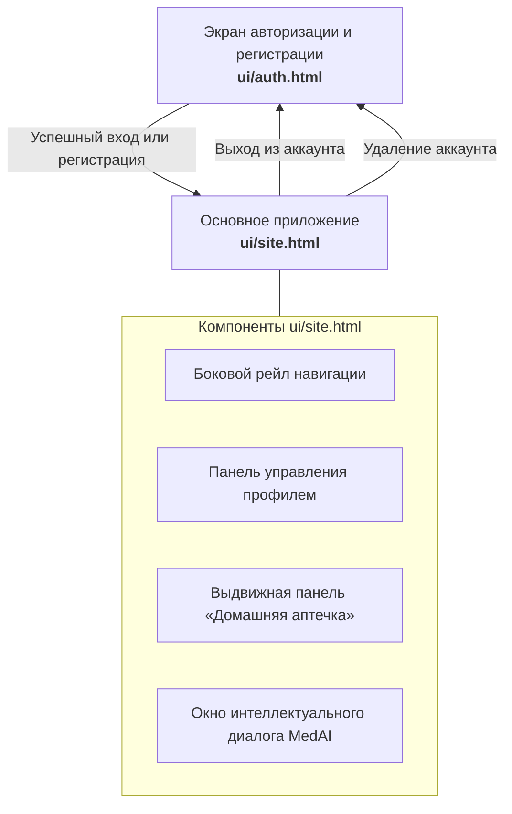

# Спецификация пользовательского интерфейса (UI/UX)

Документ описывает структуру, компоненты, визуальные токены и логику взаимодействия пользовательского интерфейса системы **MedAI** на основе утвержденного макета ([ui/auth.html](../../ui/auth.html), [ui/site.html](../../ui/site.html)).

---

## 1. Общая карта экранов и переходов

---

## 2. Дизайн-система (Design Tokens)

Интерфейс оформлен в чистой медицинской стилистике с доминантой изумрудного зеленого цвета:

| CSS-токен | Значение HEX | Назначение |
|---|---|---|
| `--green` | `#019F74` | Основной акцентный цвет (кнопки, активные чипсы, аватары) |
| `--green-dark` | `#017a5a` | Цвет кнопок при наведении (Hover) |
| `--green-light` | `#e6f7f2` | Фон выбранных элементов и чипсов лекарств |
| `--bg-chat` | `#f0f1f3` | Фоновый цвет контейнера сообщений |
| `--bg-pattern` | `#f7f9fa` | Фоновый цвет страниц с фоновой текстурой капсул |
| `--card` | `#ffffff` | Фон карточек, модальных окон и сообщений бота |
| `--text` | `#1a1a1a` | Основной цвет заголовков и текста |
| `--text-muted` | `#7a7f85` | Пояснительный текст, плейсхолдеры, вторичные метки |
| `--border` | `#e5e7eb` | Разделители, границы полей ввода и карточек |
| `--danger` | `#e5484d` | Ошибки валидации, кнопки удаления, опасные состояния |

---

## 3. Детализация экранов интерфейса

### 3.1. Экран авторизации ([ui/auth.html](../../ui/auth.html))

Экран предназначен для входа пользователей в систему и создания нового аккаунта.

- **Шапка формы:**
  - Градиентная иконка медицинской аптечки.
  - Название сервиса: «MedAI».
  - Подзаголовок: «Умная домашняя аптечка».
- **Переключатель режимов (Табы):**
  - Таб «Вход» — переключает на форму авторизации (`#loginForm`).
  - Таб «Регистрация» — переключает на форму регистрации (`#registerForm`).
- **Форма входа:**
  - Поле Email с валидацией по регулярному выражению.
  - Поле Пароль с кнопкой скрытия/отображения символов (минимум 6 знаков).
  - Кнопка «Войти» с индикатором загрузки при сабмите.
- **Форма регистрации:**
  - Поле «Имя» (минимум 2 символа).
  - Поле Email.
  - Поле «Пароль» и поле «Повторите пароль» с проверкой совпадения.
  - Кнопка «Создать аккаунт».
- **Клиентское состояние:** при успешном входе идентификатор пользователя сохраняется в `localStorage.setItem('medai_user', email)` и выполняется редирект на `site.html`.

---

### 3.2. Основное рабочее пространство ([ui/site.html](../../ui/site.html))

#### 3.2.1. Левый рейл навигации (`.side-rail`)
Фиксированная вертикальная панель шириной 64px:
- **Кнопка профиля (`#profileBtn`):** отображает инициалы пользователя или фото, открывает панель профиля.
- **Кнопка вызова аптечки (`#toggleBtn`):** открывает боковую панель инвентаря аптечки.

#### 3.2.2. Панель профиля (`.profile-panel`)
Всплывающее меню управления учетной записью:
- **Отображение данных:** крупный аватар, имя пользователя и email.
- **Действия:** переход в режим редактирования, кнопка «Удалить аккаунт» (с модальным подтверждением), кнопка «Выйти».
- **Режим редактирования:** смена аватара (с валидацией размера и типа изображения), изменение имени и контактного адреса.

#### 3.2.3. Выдвижная панель аптечки (`.sidebar`)
Инструмент инвентаризации домашних медикаментов:
- **Поиск (`#searchInput`):** мгновенная фильтрация по названию препарата.
- **Теги-фильтры (`#tagsFilter`):** горизонтальный список симптоматических категорий (*жар, боль, головная боль, воспаление, антибиотик, аллергия, ЖКТ, спазм, ожоги, антисептик*).
- **Список препаратов (`#medList`):** карточки лекарств. Каждая карточка содержит:
  - Наименование медикамента (например, Парацетамол, Ибупрофен, Амоксициллин, Дротаверин, Пантенол).
  - Список тегов назначения.
  - Кнопку удаления препарата с иконкой корзины.
- **Интеграция с чатом:** клик по карточке препарата выделяет его и помещает бейдж в панель активного контекста чата (`.selected-bar`).
- **Добавление медикамента (`#addBtn`):** открывает модальное окно добавления нового препарата в аптечку.

#### 3.2.4. Рабочая зона чата (`.chat-shell`)
Диалоговый интерфейс взаимодействия с ассистентом:
- **История сообщений (`#messages`):**
  - Приветственное сообщение ассистента с аватаром.
  - Сообщения пользователя (прижаты вправо, зеленый фон, содержат текст и бейджи выбранных препаратов).
  - Сообщения MedAI (прижаты влево, белый фон, содержат структурированный анализ, рекомендации, дозировки и предупреждения).
- **Панель прикрепленных препаратов (`#selectedBar`):** отображает чипсы лекарств, выбранных в аптечке слева, с возможностью удаления каждого чипса.
- **Зона ввода (`.input-area`):**
  - Многострочное текстовое поле `#input` с автоподстройкой высоты под объем текста.
  - Кнопка отправки `#sendBtn` (активна при наличии текста или выбранных лекарств).
  - Поддержка отправки по нажатию клавиши `Enter` (перенос строки по `Shift + Enter`).

---

## 4. Отражение ролей User и Admin в интерфейсе

В соответствии с требованиями курса в системе разграничиваются две роли:
1. **Пользователь (User):** работает в основном интерфейсе `site.html`, ведет инвентарь своей аптечки, отправляет симптоматические вопросы и получает дозировки из инструкций.
2. **Администратор (Admin):** обладает правами управления корпусом медицинских документов, инициирует переиндексацию алгоритма BM25 и просматривает метрики бенчмаркинга информационного поиска (структура эндпоинтов администрирования формализована в [spec/tech/api.md](../tech/api.md)).
