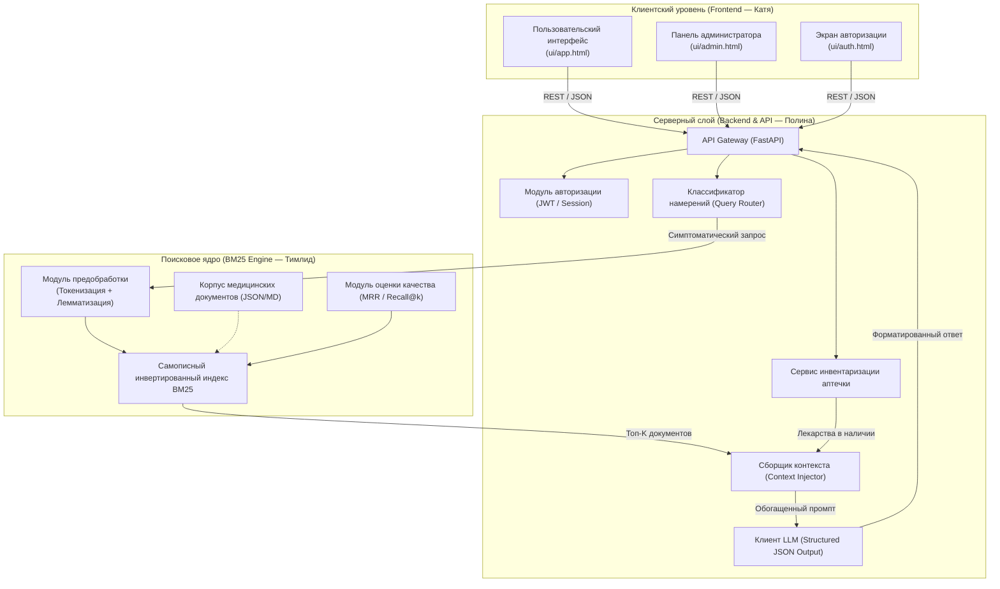

# Архитектура системы (Technical Architecture)

Документ описывает структуру модулей, потоки данных и технические решения программного комплекса **MedAI**.

---

## 1. Концептуальная архитектура (High-Level Architecture)

Система построена по сервисно-модульному принципу, обеспечивающему строгую изоляцию зон ответственности каждого из трех участников команды.

---

## 2. Потоки данных (Data Flow)

### 2.1. Сквозной поток обработки поискового запроса:
1. **Клиентский запрос:** Пользователь отправляет текстовый запрос $q$ через форму ввода.
2. **Маршрутизация (Router):** 
   - Если запрос классифицирован как экстренный (наличие триггеров: кровотечение, шок, ожог) — немедленный возврат инструкций первой помощи без задержек.
   - Если запрос является стандартным описанием симптомов — передача в поисковый движок.
3. **Поисковая обработка (BM25 Core):**
   - Нормализация, токенизация и лемматизация запроса $q \rightarrow \{t_1, t_2, \dots, t_m\}$.
   - Вычисление релевантности $BM25(q, d)$ для каждого документа $d$ в корпусе.
   - Сортировка документов по убыванию оценки и отсечение топ-$k$ (по умолчанию $k=3$).
4. **Контекстная инъекция (Context Injection):**
   - Извлечение текущего инвентаря аптечки пользователя: $K = \{item_1, item_2, \dots, item_n\}$.
   - Формирование расширенного промпта для языковой модели:
     $$\text{Prompt} = \text{System Prompt} + \text{Query}(q) + \text{Retrieved Docs}(\{d_1, d_2, d_3\}) + \text{User Kit}(K)$$
5. **Генерация ответа (LLM):**
   - Обращение к LLM с требованием строгого структурированного вывода (JSON Schema).
   - Валидация ответа через схему Pydantic.
6. **Доставка клиенту:** Передача валидированного ответа на фронтенд для визуализации.

---

## 3. Разделение ответственности и изоляция модулей

Для эффективной совместной разработки архитектура разделена на три автономных пакета:

| Модуль | Ответственный | Входные интерфейсы | Выходные артефакты |
|---|---|---|---|
| **Search Engine (`bm25/`)** | Тимлид | Текстовый запрос, корпус документов | Отсортированный список `[(doc_id, score, text)]`, отчет бенчмарка |
| **Backend & API (`app/`)** | Полина | HTTP-запросы от UI, вызовы к `bm25` | Эндпоинты REST API, JWT-сессии, Pydantic-модели, интеграция с LLM |
| **Frontend UI (`ui/`)** | Катя | Спецификация REST API, дизайн-система | HTML/CSS/JS интерфейсы, обработка состояний, адаптивная верстка |

---

## 4. Нефункциональные требования (NFR)

1. **Производительность поиска:** Время отклика самописного алгоритма BM25 на корпусе до 10 000 документов не должно превышать 50 миллисекунд.
2. **Время генерации ответа:** Общий latency запроса (включая обращение к LLM) не должен превышать 2.5 секунд.
3. **Строгая воспроизводимость:** Поисковый индекс BM25 должен выдавать идентичный список документов и скоров при неизменном корпусе и запросе.
4. **Автономность поиска:** Поисковый модуль BM25 работает локально без внешних сетевых вызовов, гарантируя работоспособность базы знаний даже при отсутствии интернета.
