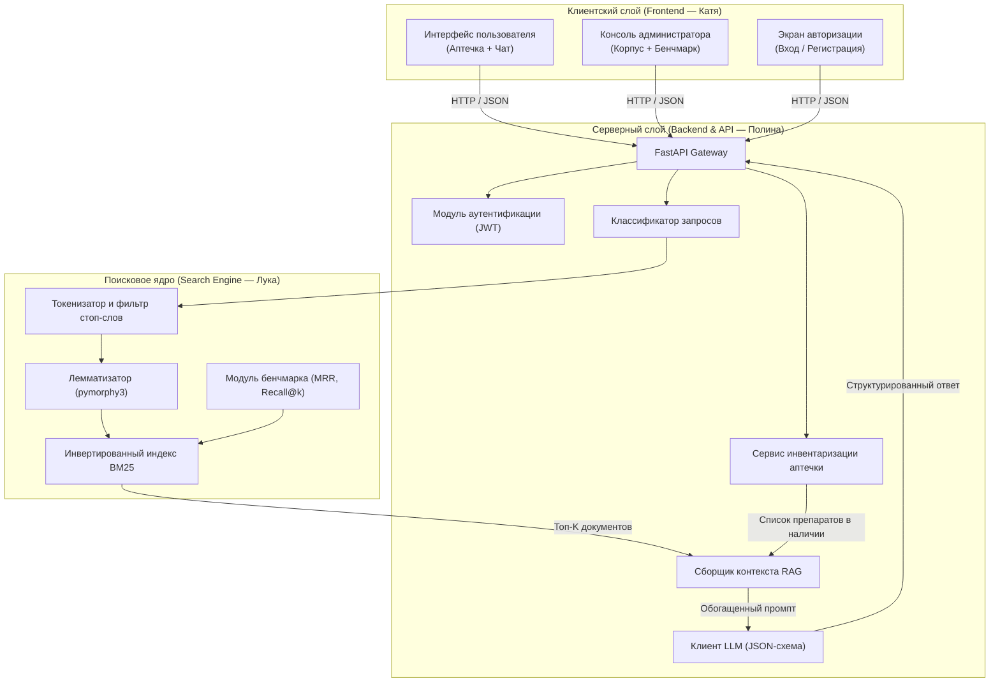

# Архитектура системы (Technical Architecture)

---

## 1. Компонентная структура системы

Архитектура системы MedAI разделена на три автономных слоя в соответствии с зонами ответственности команды:

---

## 2. Потоки данных (Data Flow)

### 2.1. Сквозной путь симптоматического запроса:
1. **Вход:** Фронтенд отправляет `POST /api/v1/chat/query` с текстом запроса.
2. **Маршрутизация:** Классификатор проверяет запрос на экстренные ключевые слова (`ожог`, `кровотечение`). При совпадении немедленно возвращается протокол Red Flag без обращения к поиску.
3. **BM25 Search:** Запрос токенизируется, лемматизируется в нормальные формы. Индекс рассчитывает оценки $BM25(q, d)$ и возвращает топ-3 фрагмента инструкций.
4. **Контекстная инъекция (Context Injection):** Бэкенд склеивает:
   $$\text{Промпт} = \text{Инструкция системная} + \text{Вопрос пользователя} + \text{Топ-3 инструкций BM25} + \text{Препараты в аптечке}$$
5. **Генерация и валидация:** LLM возвращает строгий JSON, который верифицируется схемой Pydantic.
6. **Выход:** Ответ с карточкой препарата, дозировкой и источником передается клиенту.

### 2.2. Интеграционный слой Seamless Fallback (двойной режим)
Взаимодействие клиентского слоя (`ui/`) и серверного слоя (`app/`) спроектировано по принципу **Seamless Fallback**:
1. Все клиентские страницы обращаются к единому REST API (`http://localhost:8000/api/v1`) по контрактам [spec/tech/api.md](api.md).
2. При запущенном FastAPI-сервере Полины клиент потребляет живые данные базы PostgreSQL и инференс LLM.
3. При отсутствии сетевого ответа от сервера (режим демонстрации КТ1 или автономный запуск без бэкенда) клиент перехватывает сбой сети и активирует локальный демонстрационный режим на базе `localStorage` и шаблонного генератора без падения страницы. При последующем запуске сервера клиент мгновенно подхватывает реальный бэкенд без правок кода.

---

## 3. Изоляция модулей и организация репозитория

Для параллельной работы участников репозиторий делится на пакеты:
- `ui/` — клиентский веб-интерфейс (`ui/auth.html`, `ui/site.html`, `ui/admin.html`, разработка и развитие — Катя).
- `app/` — серверный код на FastAPI, схемы API, Pydantic-модели, интеграция с LLM (Полина).
- `bm25/` — самописный поисковый индекс, токенизатор, корпус документов (Лука).
- `benchmark/` — раннер тестов, эталонный датасет `golden_dataset.json` (Лука).
- `spec/` — единые спецификации требований SDD (общая зона).

---

## 4. Нефункциональные требования (NFR)

1. **Задержка поиска (BM25 Latency):** Время ранжирования по корпусу до $10^4$ документов — **не более 50 мс**.
2. **Общее время ответа:** Полный цикл обработки запроса (включая LLM) — **до 2.5 с**.
3. **Автономность:** Поисковый индекс BM25 работает полностью локально без внешних сетевых вызовов.
4. **Безопасность:** Секретные ключи API для LLM хранятся только в `.env` и никогда не попадают в репозиторий.
