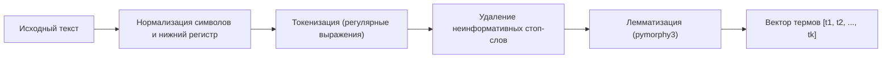

# Спецификация поисковой модели BM25 и RAG

Спецификация регламентирует математический аппарат поискового алгоритма BM25 в соответствии с заданием НИРС (`НИРС.pdf`), конвейер предобработки текстов и сборку промпта.

---

## 1. Математическая модель BM25

Использование сторонних поисковых библиотек запрещено заданием НИРС. Алгоритм реализуется с нуля на этапе КТ2.

### 1.1. Параметры корпуса
- $N$ — общее число документов в корпусе.
- $V = \{t_1, t_2, \dots, t_m\}$ — словарь уникальных термов.
- $|d|$ — длина документа $d$ (число термов после предобработки).
- $avgdl = \frac{1}{N} \sum_{i=1}^N |d_i|$ — средняя длина документа в корпусе.
- $TF(t, d)$ — частота терма $t$ в документе $d$.
- $DF(t)$ — число документов корпуса, содержащих терм $t$.

### 1.2. Обратная документная частота (IDF)
Согласно методическим указаниям НИРС (раздел 1.3):
$$IDF(t) = \ln \left( 1 + \frac{N - DF(t) + 0.5}{DF(t) + 0.5} \right)$$

### 1.3. Формула ранжирования BM25
Для запроса $q$, состоящего из термов $t \in q$, функция релевантности документа $d$ вычисляется как:
$$BM25(q, d) = \sum_{t \in q} IDF(t) \cdot \frac{TF(t, d) \cdot (k_1 + 1)}{TF(t, d) + k_1 \cdot \left(1 - b + b \cdot \frac{|d|}{avgdl}\right)}$$

- **$k_1 = 1.5$** — параметр насыщения частоты терма.
- **$b = 0.75$** — параметр штрафа за длину документа.

---

## 2. Конвейер предобработки текста



### 2.1. Обоснование выбора лемматизатора
- **Инструмент:** `pymorphy3` (OpenCorpora).
- **Причина выбора:** Высокая точность лемматизации русского языка с учетом падежей, чисел и глагольных форм («болит» $\rightarrow$ «болеть», «таблетками» $\rightarrow$ «таблетка»). Детерминированная работа в чистом Python без платформозависимых компилируемых C++ модулей.

---

## 3. Структура инвертированного индекса

Индекс хранится в оперативной памяти в виде хэш-таблицы:

```text
Словарь инвертированного индекса:
{
  "голова":      [(doc_001, tf=3), (doc_008, tf=2)],
  "ибупрофен":   [(doc_001, tf=7)],
  "спазм":       [(doc_003, tf=4)],
  ...
}

Метаданные документов:
{
  "doc_001": { "title": "Ибупрофен 200мг", "len": 184, "category": "НПВП" },
  "doc_003": { "title": "Дротаверин 40мг", "len": 142, "category": "Спазмолитики" }
}
```

---

## 4. Контекстная инъекция (Context Injection)

### 4.1. Шаблон системного промпта
```text
Ты — медицинский консультант MedAI.
Твоя задача — помочь пользователю подобрать препарат из ЕГО АПТЕЧКИ на основе официальных инструкций.

ПРАВИЛА:
1. Опирайся ИСКЛЮЧИТЕЛЬНО на предоставленные инструкции. Не придумывай дозировки.
2. Сопоставь найденные препараты с наличием в аптечке пользователя.
3. Укажи точный способ применения и противопоказания.
4. Ответ верни СТРОГО в формате JSON.

НАЙДЕННЫЕ ИНСТРУКЦИИ (TOP-3 BM25):
{retrieved_documents}

АПТЕЧКА ПОЛЬЗОВАТЕЛЯ:
{user_kit_items}

ВОПРОС:
{user_query}
```

### 4.2. Схема JSON-ответа
```json
{
  "status": "success",
  "recommendation": {
    "medicine_name": "Ибупрофен",
    "in_user_kit": true,
    "dosage": "1 таблетка (200 мг) после еды",
    "contraindications": "Язва ЖКТ, тяжелая почечная недостаточность",
    "warnings": "Не превышать 1200 мг в сутки"
  },
  "emergency_level": "none",
  "sources": ["Инструкция ЛП-001234: Ибупрофен 200мг"],
  "disclaimer": "Информация носит ознакомительный характер. При усилении симптомов обратитесь к врачу."
}
```
