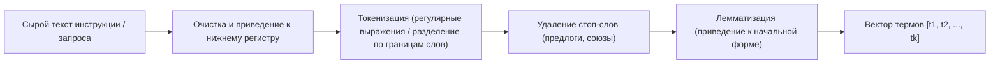

# Спецификация поисковой системы BM25 и RAG (Search & Retrieval)

Спецификация разработана на основе методических указаний к НИРС (`НИРС.pdf`) и регламентирует математический аппарат, алгоритмы предобработки и конвейер генерации ответов.

---

## 1. Математический аппарат поисковой модели BM25

В соответствии с заданием НИРС используется классическая вероятностная модель ранжирования **BM25 (Best Matching 25)**. Использование сторонних готовых поисковых библиотек запрещено — алгоритм реализуется с нуля на этапе КТ2.

### 1.1. Базовые характеристики корпуса
- $N$ — общее число документов в медицинском корпусе.
- $V = \{t_1, t_2, \dots, t_m\}$ — словарь уникальных термов корпуса.
- $|d|$ — длина документа $d$ (количество термов в документе после предобработки).
- $avgdl$ — средняя длина документа в корпусе:
  $$avgdl = \frac{1}{N} \sum_{i=1}^N |d_i|$$
- $TF(t, d)$ — частота терма $t$ в документе $d$ (Term Frequency).
- $DF(t)$ — число документов в корпусе, содержащих терм $t$ (Document Frequency).

### 1.2. Формула обратной документной частоты (IDF)
Согласно разделу 1.3 методических указаний НИРС:
$$IDF(t) = \ln \left( 1 + \frac{N - DF(t) + 0.5}{DF(t) + 0.5} \right)$$
Данная формула предотвращает деление на ноль и исключает отрицательные веса для высокочастотных термов корпуса.

### 1.3. Формула функции релевантности BM25
Для поискового запроса $q$, состоящего из термов $\{t_1, \dots, t_k\}$, оценка соответствия документа $d$ вычисляется как:
$$BM25(q, d) = \sum_{t \in q} IDF(t) \cdot \frac{TF(t, d) \cdot (k_1 + 1)}{TF(t, d) + k_1 \cdot \left(1 - b + b \cdot \frac{|d|}{avgdl}\right)}$$

### 1.4. Гиперпараметры алгоритма
- **Параметр $k_1 \in [1.2, 2.0]$:** калибрует скорость насыщения частоты термина $TF$. Значение по умолчанию: $k_1 = 1.5$.
- **Параметр $b \in [0, 1]$:** управляет степенью штрафа за длину документа. Значение по умолчанию: $b = 0.75$. При $b=0$ нормализация отключена, при $b=1$ выполняется полная нормализация относительно $avgdl$.

---

## 2. Конвейер предварительной обработки текста (Preprocessing)

В соответствии с требованиями НИРС выбор этапов предобработки строго обоснован.



### 2.1. Токенизация
Разбиение текста на последовательность атомарных смысловых единиц (токенов). Токенизатор отсекает пунктуационные символы и спецзнаки, сохраняя дефисные медицинские термины (например, «желудочно-кишечный»).

### 2.2. Обоснование выбора метода лемматизации
- **Выбранный инструмент:** `pymorphy3` (актуальный форк OpenCorpora).
- **Обоснование:**
  1. В отличие от стемминга (отсечения окончаний по Сноуболлу), лемматизация находит реальные нормальные словарные формы слов русского языка («болит» $\rightarrow$ «болеть», «лекарства» $\rightarrow$ «лекарство»), что критично для медицинской терминологии с богатым словоизменением.
  2. Чистая реализация на Python без тяжелых C++ зависимостей, высокая детерминированность и воспроизводимость на любых платформах (Linux, macOS, Windows).

### 2.3. Фильтрация стоп-слов
Удаляются общеупотребительные союзы и междометия («и», «или», «что», «как»).  
*Важное исключение:* отрицательные частицы («не», «без») в медицинском поиске обрабатываются с осторожностью, чтобы не исказить смысл противопоказаний.

---

## 3. Архитектура инвертированного индекса

Индекс строится как разреженное представление корпуса:

```
Инвертированный индекс (Inverted Index):
{
  "голова":      [(doc_1, tf=3), (doc_4, tf=1)],
  "ибупрофен":   [(doc_1, tf=8)],
  "спазм":       [(doc_2, tf=4), (doc_4, tf=2)],
  ...
}

Метаданные документов:
{
  doc_1: { title: "Ибупрофен 200мг", length: 184, category: "НПВП" },
  doc_2: { title: "Дротаверин 40мг", length: 120, category: "Спазмолитики" }
}
```

---

## 4. Контекстная инъекция (Context Injection) в RAG

Для генерации ответа формируется расширенный промпт, связывающий документы из поиска BM25 с профилем домашней аптечки.

### 4.1. Шаблон промпта (System Prompt):
```text
Ты — квалифицированный медицинский ассистент MedAI.
Твоя задача — помочь пользователю подобрать препарат из ЕГО ДОМАШНЕЙ АПТЕЧКИ на основе проверенных инструкций.

ПРАВИЛА:
1. Отвечай СТРОГО на основе предоставленных фрагментов медицинских инструкций.
2. Проверь наличие подходящих препаратов в аптечке пользователя. Если препарат есть в аптечке — рекомендуй его в первую очередь.
3. Обязательно укажи точную дозировку и способ применения из инструкции.
4. Укажи основные противопоказания.
5. Заверши ответ обязательным дисклеймером о консультации с врачом.
6. Ответ должен быть в формате строгого JSON.

НАЙДЕННЫЕ ИНСТРУКЦИИ (TOP-3 BM25):
{retrieved_documents}

СОСТАВ АПТЕЧКИ ПОЛЬЗОВАТЕЛЯ:
{user_kit_items}

ВОПРОС ПОЛЬЗОВАТЕЛЯ:
{user_query}
```

### 4.2. Схема структурированного JSON-ответа:
```json
{
  "status": "success",
  "recommendation": {
    "medicine_name": "Ибупрофен",
    "in_user_kit": true,
    "dosage": "1 таблетка (200 мг) после еды",
    "indications": "Головная боль умеренной интенсивности",
    "contraindications": "Язвенная болезнь ЖКТ, тяжелая почечная недостаточность",
    "warnings": "Не превышать суточную дозу 1200 мг"
  },
  "emergency_level": "none",
  "sources": ["Инструкция Минздрава: Ибупрофен ЛП-001234"],
  "disclaimer": "Информация носит ознакомительный характер. При ухудшении состояния обратитесь к врачу."
}
```
