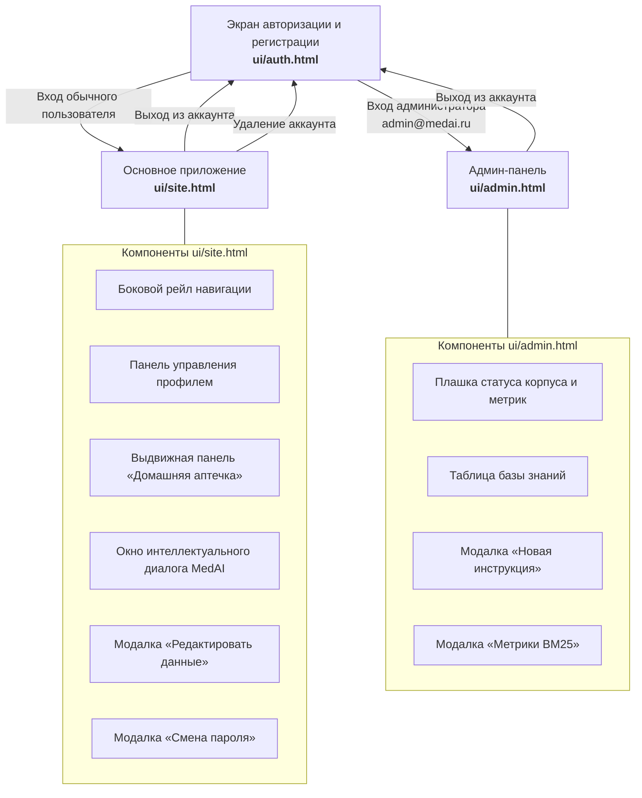

# Спецификация пользовательского интерфейса (UI/UX)

Документ описывает структуру, компоненты, визуальные токены и логику взаимодействия пользовательского интерфейса системы **MedAI** на основе дизайн-системы и макетов Каты ([ui/auth.html](../../ui/auth.html), [ui/site.html](../../ui/site.html), [ui/admin.html](../../ui/admin.html)). Спецификация согласована командой в рамках методологии SDD.

---

## 1. Общая карта экранов и переходов

---

## 2. Дизайн-система (Design Tokens)

Интерфейс оформлен в чистой медицинской стилистике с доминантой изумрудного зеленого цвета:

| CSS-токен | Значение HEX | Назначение |
|---|---|---|
| `--green` | `#019F74` | Основной акцентный цвет (кнопки, активные чипсы, аватары) |
| `--green-dark` | `#017a5a` | Цвет кнопок при наведении (Hover) |
| `--green-light` | `#e6f7f2` | Фон выбранных элементов и чипсов лекарств |
| `--bg-chat` | `#f0f1f3` | Фоновый цвет контейнера сообщений |
| `--bg-pattern` | `#f7f9fa` | Фоновый цвет страниц с фоновой текстурой капсул |
| `--card` | `#ffffff` | Фон карточек, модальных окон и сообщений бота |
| `--text` | `#1a1a1a` | Основной цвет заголовков и текста |
| `--text-muted` | `#7a7f85` | Пояснительный текст, плейсхолдеры, вторичные метки |
| `--border` | `#e5e7eb` | Разделители, границы полей ввода и карточек |
| `--danger` | `#e5484d` | Ошибки валидации, кнопки удаления, опасные состояния |

---

## 3. Детализация экранов интерфейса

### 3.1. Экран авторизации ([ui/auth.html](../../ui/auth.html))

Экран предназначен для входа пользователей в систему и создания нового аккаунта.

- **Шапка формы:**
  - Градиентная иконка медицинской аптечки.
  - Название сервиса: «MedAI».
  - Подзаголовок: «Умная домашняя аптечка».
- **Переключатель режимов (Табы):**
  - Таб «Вход» — переключает на форму авторизации (`#loginForm`).
  - Таб «Регистрация» — переключает на форму регистрации (`#registerForm`).
- **Форма входа:**
  - Поле Email с валидацией по регулярному выражению.
  - Поле Пароль с кнопкой скрытия/отображения символов (минимум 6 знаков).
  - Кнопка «Войти» с индикатором загрузки при сабмите.
- **Форма регистрации:**
  - Поле «Имя» (минимум 2 символа).
  - Поле Email.
  - Поле «Пароль» и поле «Повторите пароль» с проверкой совпадения.
  - Кнопка «Создать аккаунт».
- **Клиентское состояние:** при успешном входе идентификатор пользователя сохраняется в `localStorage.setItem('medai_user', email)`, роль — в `localStorage.setItem('medai_role', ...)`, после чего выполняется редирект: `admin@medai.ru` → `admin.html`, все остальные → `site.html`. Регистрация всегда выставляет роль `user`.

---

### 3.2. Основное рабочее пространство ([ui/site.html](../../ui/site.html))

#### 3.2.1. Левый рейл навигации (`.side-rail`)
Фиксированная вертикальная панель шириной 64px:
- **Кнопка профиля (`#profileBtn`):** отображает инициалы пользователя или фото, открывает панель профиля.
- **Кнопка вызова аптечки (`#toggleBtn`):** открывает боковую панель инвентаря аптечки.

#### 3.2.2. Панель профиля (`.profile-panel`)
Всплывающее меню управления учетной записью:
- **Отображение данных:** крупный аватар, имя пользователя и email.
- **Действия:** «Редактировать данные», «Сменить пароль», «Выйти», «Удалить аккаунт» (с модальным подтверждением).
- **Модалка «Редактировать данные» (`#editBackdrop`):** отдельное окно поверх рабочей зоны чата, ширина повторяет контейнер чата (960px), высота — 50% экрана (`50vh`). Внутри, столбиком: загрузка аватара (валидация до 5 МБ, удаление фото), поле «Имя», поле «Email», кнопки «Отмена» и «Сохранить». Открывается по кнопке «Редактировать данные» (панель профиля закрывается), закрывается по кнопке, клику по фону и клавише `Escape`.
- **Модалка «Смена пароля» (`#passwordBackdrop`):** открывается пунктом «Сменить пароль» в меню профиля. Поля: текущий пароль, новый пароль, подтверждение. Валидация: не короче 6 символов, совпадение подтверждения. Каждое поле снабжено кнопкой показа символов (`.toggle-pass`) на правом краю — переключает режим `password`/`text` и иконку (открытый глаз / перечеркнутый), как на экране `auth.html`. При закрытии и повторном открытии состояние сбрасывается в скрытое. При успешном сохранении отображается подтверждение «Пароль обновлён», окно закрывается автоматически.

#### 3.2.3. Выдвижная панель аптечки (`.sidebar`)
Инструмент инвентаризации домашних медикаментов:
- **Поиск (`#searchInput`):** мгновенная фильтрация по названию препарата.
- **Теги-фильтры (`#tagsFilter`):** горизонтальный список симптоматических категорий (*жар, боль, головная боль, воспаление, антибиотик, аллергия, ЖКТ, спазм, ожоги, антисептик*).
  Логика комбинации — **И** (пересечение): при выборе нескольких тегов выводятся только препараты, содержащие все выбранные теги одновременно (например, «боль» + «жар» — только комбинированные анальгетики-антипиретики). Пустое состояние: «Нет лекарств со всеми выбранными тегами».
- **Список препаратов (`#medList`):** карточки лекарств. Каждая карточка содержит:
  - Наименование медикамента (например, Парацетамол, Ибупрофен, Амоксициллин, Дротаверин, Пантенол).
  - Список тегов назначения.
  - Кнопку удаления препарата с иконкой корзины.
- **Интеграция с чатом:** клик по карточке препарата выделяет его и помещает бейдж в панель активного контекста чата (`.selected-bar`).
- **Добавление медикамента (`#addBtn`):** открывает модальное окно добавления нового препарата в аптечку (`#modalBackdrop`). Модалка содержит поля:
  - «Название» (`#newName`) — валидация непустого значения.
  - «Форма выпуска» (`#newForm`) — селектор/ввод (таблетки, капсулы, сироп, спрей, мазь, капли).
  - «Дозировка» (`#newDosage`) — текстовое поле (например, 500 мг, 200 мг/5 мл).
  - «Теги / симптомы» (`#newTags`) — список симптомов через запятую.

#### 3.2.4. Рабочая зона чата (`.chat-shell`)
Диалоговый интерфейс взаимодействия с ассистентом (контейнер: `max-width: 960px`):
- **История сообщений (`#messages`):**
  - Приветственное сообщение ассистента с аватаром и пометкой «Демо-ответ».
  - Сообщения пользователя (прижаты вправо, зеленый фон, содержат текст и бейджи выбранных препаратов).
  - Сообщения MedAI (прижаты влево, белый фон, содержат структурированный ответ). Каждое сообщение ассистента, включая приветствие, несет бейдж `.msg-demo-label` «Демо-ответ» в правом верхнем углу пузыря (мелкий серый пилл: `--text-muted`, фон `#f1f3f4`) — маркер демо-ответов прототипа. Сообщения пользователя бейдж не имеют.
  - Структура ответа ассистента:
    - **Карточка RAG-ответа (`.rag-card`):**
      - Заголовок с названием препарата и индикатором наличия в домашней аптечке (`.badge-in-kit` «Есть в вашей аптечке» / `.badge-out-kit` «Нет в наличии»).
      - Секция «Режим дозирования» (`.rag-section`).
      - Секция «Противопоказания и предупреждения» (`.rag-section`).
      - Мета-данные (`.rag-meta`): ссылка на валидированную инструкцию Минздрава РФ и обязательный медицинский дисклеймер.
    - **Блок критических симптомов Red Flags (`.emergency-card`):** ярко-красный предупреждающий блок при выявлении жизнеугрожающих состояний (боль за грудиной, одышка, спутанность сознания, судороги) с категорическим требованием немедленного вызова скорой помощи по номеру 112.
- **Панель прикрепленных препаратов (`#selectedBar`):** отображает чипсы лекарств, выбранных в аптечке слева, с возможностью удаления каждого чипса.
- **Зона ввода (`.input-area`):**
  - Многострочное текстовое поле `#input` с автоподстройкой высоты под объем текста.
  - Кнопка отправки `#sendBtn` (активна при наличии текста или выбранных лекарств).
  - Поддержка отправки по нажатию клавиши `Enter` (перенос строки по `Shift + Enter`).
- **Сетевое взаимодействие:** клиент обращается по REST API к эндпоинту `POST /api/v1/chat/query`. При недоступности бэкенда автоматически активируется локальный демонстрационный режим с формированием идентичной структуры карточки.

---

### 3.3. Админ-панель ([ui/admin.html](../../ui/admin.html))

Экран управления корпусом медицинских инструкций. Не содержит диалогового окна чата.

- **Левый рейл:** логотип сервиса и кнопка «Выйти» (возврат на `auth.html`, очистка `medai_role`).
- **Плашка статуса (`.stat-bar`):**
  - «Инструкций в базе: {N} | Поиск BM25: активен».
  - Кнопка «Метрики BM25» (`#benchBtn`) для инспекции точности поискового ядра.
- **Модалка бенчмарка BM25 (`#benchBackdrop`):**
  - Отображает результаты верификации поискового ядра согласно [spec/tech/benchmark.md](../../spec/tech/benchmark.md):
    - $MRR = 0.842$ (порог допуска $\ge 0.75$);
    - $Recall@1 = 77.8\%$ (35/45);
    - $Recall@3 = 91.1\%$ (41/45);
    - $Recall@5 = 95.6\%$ (43/45);
    - Латентность $P_{95} = 12\text{ мс}$, параметры $k_1 = 1.5, b = 0.75$.
- **Кнопка «Добавить инструкцию в базу»** → модальное окно с полями: название, категория, текст аннотации (textarea). Валидация непустых полей и проверка на дубликат названия.
- **Таблица корпуса:** колонки «Название», «Категория», «Аннотация» (обрезка до двух строк с полным текстом во всплывающей подсказке) и кнопка удаления с модальным подтверждением.
- **Инлайн-редактирование:** в каждой ячейке кнопка-карандашик (`.cell-edit`). По нажатию ячейка заменяется на поле ввода (textarea — для аннотации) с кнопками «Сохранить» (галочка) и «Отмена» (крестик). Горячие клавиши: `Enter` — сохранить, в textarea — `Ctrl+Enter`, `Escape` — отмена. Редактируется одна ячейка за раз. Ошибки: пустое поле, дубликат названия.
- **Хранение:** корпус сохраняется в `localStorage` под ключом `medai_corpus`.

---

## 4. Отражение ролей User и Admin в интерфейсе

В соответствии с требованиями курса в системе разграничиваются две роли:
1. **Пользователь (User):** работает в интерфейсе `site.html`, ведет инвентарь своей аптечки, отправляет симптоматические вопросы и получает дозировки из инструкций. Элементы администрирования в его интерфейсе отсутствуют.
2. **Администратор (Admin):** после входа с `admin@medai.ru` перенаправляется на `admin.html` — экран управления корпусом инструкций (добавление, редактирование, удаление документов, статус поискового индекса BM25). Вход для обеих ролей единый — `auth.html`.
