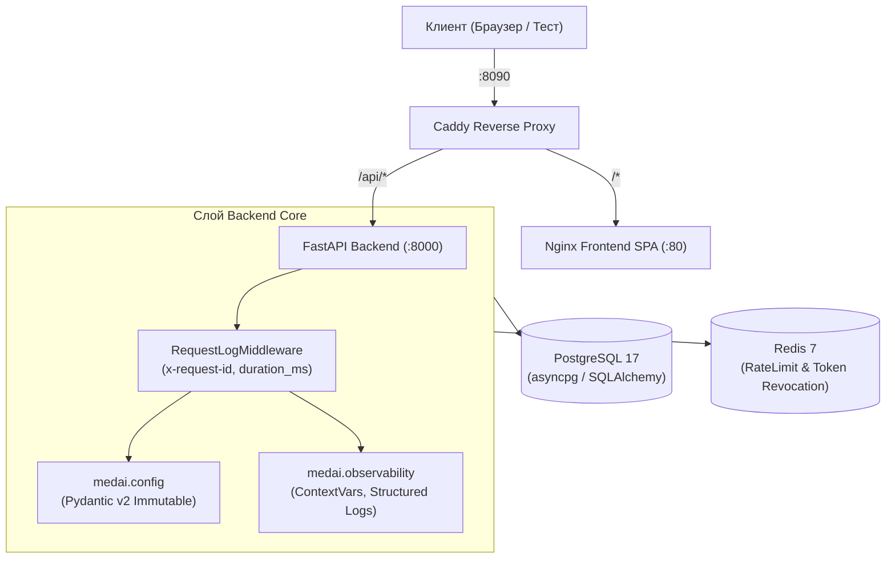

# 017-backend-infrastructure-scaffold: Инфраструктурный фундамент backend/, конфигурация, логирование и Docker

## Цель
Развернуть модульный серверный фундамент `backend/` в соответствии с эталоном BMSTU NIRS (`smeshariki-ai`), подготовить декларативную конфигурацию окружения на Pydantic v2, структурированное наблюдаемое логирование (ASGI Middleware + ContextVars) и Docker-оркестрацию полного контура (Caddy, Nginx, FastAPI, PostgreSQL 17, Redis).

## Допущения и контекст
- Используется пакетный менеджер `uv` для изолированного управления виртуальным окружением Python 3.12.
- Конфигурация считывается строго один раз при инициализации приложения из `os.environ` или переданного словаря без скрытых парсингов `.env` во время выполнения.
- Логирование защищено белым списком безопасных метаданных: персональные данные (PII), токены и пароли никогда не выводятся в терминал или JSON-логи.
- Фронтенд и бэкенд проксируются через Caddy (порт 8090) с маршрутизацией префикса `/api/*` на FastAPI-бэкенд.

## Требования
- **REQ-001:** Создать структуру `backend/` с декларативным `pyproject.toml` (сборщик `hatchling`, Python `>=3.12`), включающим зависимости: FastAPI, Pydantic v2, SQLAlchemy 2.0 (asyncio), asyncpg, Alembic, Redis, PyJWT, Argon2-cffi, Pymorphy3, LiteLLM, Pytest, Ruff.
- **REQ-002:** Реализовать `backend/src/medai/config.py` с неизменяемыми (`frozen=True`, `extra="forbid"`) моделями `Config`, `DatabaseConfig`, `RedisConfig`, `AuthConfig`, `LiteLLMProviderConfig`, `LoggingConfig`.
- **REQ-003:** Реализовать `backend/src/medai/observability.py` со структурированным логированием (human/json форматирование), контекстными переменными (`request_id`, `dialog_id`) и фильтрацией полей по белому списку `_SAFE_FIELDS`.
- **REQ-004:** Реализовать `RequestLogMiddleware`, внедряющий заголовок `x-request-id`, замеряющий длительность запроса `duration_ms` и логирующий события `http.request.started`, `http.request.completed`, `http.request.failed`, `http.request.cancelled`.
- **REQ-005:** Создать конфигурацию Docker в каталоге `docker/` (`compose.yaml`, `Dockerfile`, `frontend.Dockerfile`, `Caddyfile`, `nginx.conf`) с изолированной подсетью, healthcheck для сервисов и проксированием портов.
- **REQ-006:** Актуализировать фасад [Makefile](Makefile), добавив цели `run`, `lint`, `format`, `test`, `migrate` с бесшовной поддержкой локального `uv` и Docker.

## Сценарии взаимодействия (BDD)

### Сценарий 1: Загрузка конфигурации из переменных окружения
- **Given** установленные переменные `DATABASE_URL`, `REDIS_URL`, `AUTH_JWT_SECRET`
- **When** вызывается функция `load_config(environ)`
- **Then** возвращается экземпляр `Config` с валидированными строго типизированными полями без мутаций.

### Сценарий 2: Фильтрация конфиденциальных полей в логировании
- **Given** инициализированный логгер с форматтером `EventFormatter`
- **When** регистрируется событие через `log_event` с безопасным полем `duration_ms` и запрещенным полем `raw_password`
- **Then** система генерирует `ValueError("Unsupported log event field")`, предотвращая утечку данных.

### Сценарий 3: Прохождение запроса через RequestLogMiddleware
- **Given** ASGI-приложение с подключенным `RequestLogMiddleware`
- **When** клиент отправляет HTTP-запрос к эндпоинту `/api/v1/health`
- **Then** ответ содержит заголовок `x-request-id` с валидным UUIDv4, а в лог пишется событие `http.request.completed` со статусом 200 и временем исполнения.

## Архитектура и Data Flow

## Границы и инварианты
- **Всегда:** Строго относительные пути от корня проекта, неизменяемые модели конфигурации, Pydantic v2 валидация.
- **Никогда:** Никакого жесткого зашивания секретов в код, никаких абсолютных путей машины, никакого вывода чувствительных данных в логи.

## Критерии приемки
- [ ] Пакет `backend/` инициализирован с `pyproject.toml` и собирается через `uv`.
- [ ] Модули `medai.config` и `medai.observability` покрыты модульными тестами с прохождением 100%.
- [ ] Все тесты проходят: `make test`.
- [ ] Линтер `ruff` не выдает предупреждений и ошибок: `make lint`.
- [ ] Docker-конфигурация валидируется синтаксически.
- [ ] Отчет о верификации сформирован в `specs/changes/017-backend-infrastructure-scaffold/verification.md`.
