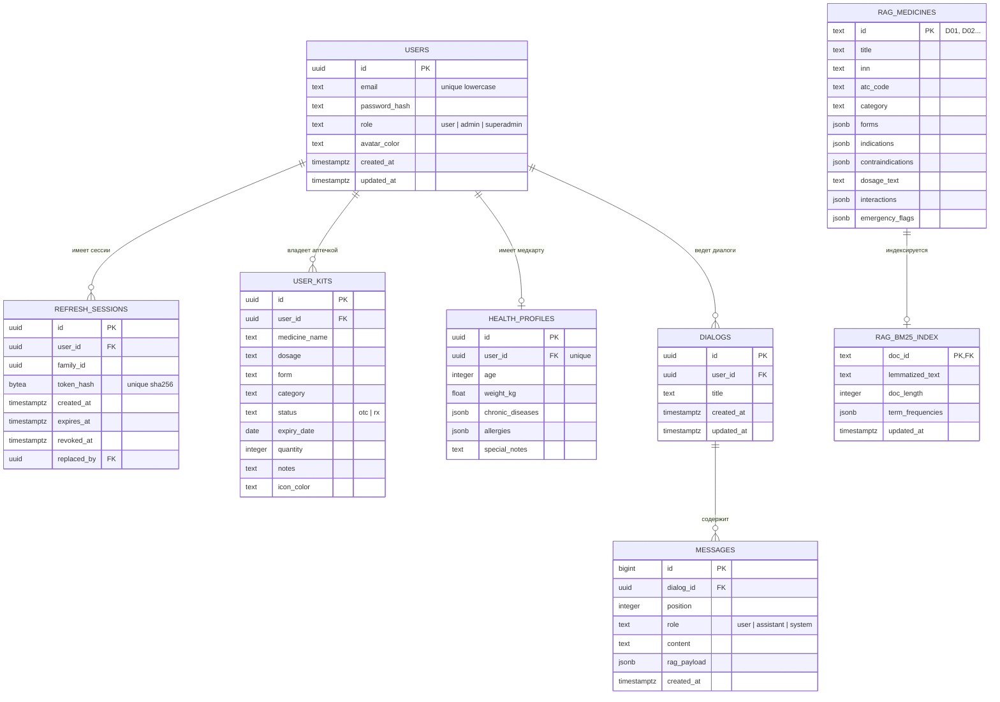

# 018-db-schema-and-migrations: Схема БД PostgreSQL, SQLAlchemy 2.0 Core и миграции Alembic

## Цель
Разработать реляционную модель базы данных PostgreSQL для интеллектуальной аптечки первой помощи MedAI с описанием таблиц на SQLAlchemy 2.0 Core, строгими ограничениями целостности (Check Constraints, Foreign Keys CASCADE) и программным конвейером миграций Alembic.

## Допущения и контекст
- СУБД проекта — PostgreSQL 17 с асинхронным драйвером `asyncpg`.
- Используется чистый SQLAlchemy 2.0 Core (`Table`, `Column`, `MetaData`), что исключает накладные расходы тяжелого ORM и обеспечивает детерминированную работу транзакций.
- Безопасность: параметр `hide_parameters=True` в движке предотвращает попадание хешей паролей и токенов в логи исключений.
- Токены обновления хранятся исключительно в виде криптографического хеша SHA-256 (`token_hash LargeBinary`) с поддержкой ротации семейств (`family_id`).

## Требования
- **REQ-001:** Создать модуль `backend/src/medai/db/tables.py` с объектом `metadata = MetaData()` и описанием таблиц:
  - `users` — учетные записи пользователей (id UUID, email, password_hash, role, avatar_color, created_at, updated_at).
  - `refresh_sessions` — сессии обновления токенов (id UUID, user_id FK CASCADE, family_id, token_hash, created_at, expires_at, revoked_at, replaced_by).
  - `user_kits` — домашняя аптечка пользователя (id UUID, user_id FK CASCADE, medicine_name, dosage, form, category, status, expiry_date, quantity, notes, icon_color).
  - `health_profiles` — медкарта пользователя (id UUID, user_id FK CASCADE UNIQUE, age, weight_kg, chronic_diseases JSONB, allergies JSONB, special_notes, created_at, updated_at).
  - `dialogs` — сессии консультаций (id UUID, user_id FK CASCADE, title, created_at, updated_at).
  - `messages` — сообщения диалога (id BigInteger Identity, dialog_id FK CASCADE, position, role, content, rag_payload JSONB, created_at).
  - `rag_medicines` — реестр официальных инструкций Минздрава РФ (id Text PK, title, inn, atc_code, category, forms JSONB, indications JSONB, contraindications JSONB, dosage_text, interactions JSONB, emergency_flags JSONB).
  - `rag_bm25_index` — инвертированный индекс и лемматизированный корпус (doc_id FK CASCADE PK, lemmatized_text, doc_length, term_frequencies JSONB, updated_at).
- **REQ-002:** Зафиксировать строгие ограничения целостности на уровне СУБД:
  - `users.role IN ('user', 'admin', 'superadmin')`.
  - Регистронезависимый уникальный индекс на `lower(users.email)`.
  - `user_kits.status IN ('otc', 'rx')`, `quantity >= 1`.
  - `health_profiles.age BETWEEN 0 AND 130`, `weight_kg BETWEEN 1.0 AND 300.0`.
  - `messages.role IN ('user', 'assistant', 'system')`, уникальность пары `(dialog_id, position)`.
- **REQ-003:** Реализовать `backend/src/medai/db/engine.py` с созданием ленивого `AsyncEngine` (`pool_pre_ping=True`, `hide_parameters=True`).
- **REQ-004:** Сконфигурировать окружение Alembic (`backend/src/medai/db/migrations/`) и модуль программного применения миграций `backend/src/medai/db/migrate.py`.
- **REQ-005:** Сформировать стартовую миграцию `0001_initial_schema.py` для развертывания полного набора таблиц и индексов.
- **REQ-006:** Покрыть реляционную модель тестами: валидация метаданных, проверка ограничений и синтаксиса миграций.

## Сценарии взаимодействия (BDD)

### Сценарий 1: Проверка ограничений ролей пользователей
- **Given** таблица `users` в схеме базы данных
- **When** производится валидация метаданных таблицы
- **Then** присутствует CheckConstraint `users_role_valid` со списком допустимых значений `user`, `admin`, `superadmin`.

### Сценарий 2: Связь домашней аптечки и пользователя
- **Given** таблица `user_kits`
- **When** проверяется внешний ключ `user_id`
- **Then** внешний ключ указывает на `users.id` с правилом каскадного удаления `ON DELETE CASCADE`.

### Сценарий 3: Структура RAG-хранилища
- **Given** таблицы `rag_medicines` и `rag_bm25_index`
- **When** проверяется первичный ключ и типы данных
- **Then** `rag_medicines.id` является строковым идентификатором (например, `D01`), а `rag_bm25_index.doc_id` ссылается на него с каскадным удалением.

## Архитектура ERD (Entity-Relationship)

## Границы и инварианты
- **Всегда:** Каскадное удаление данных пользователя при удалении аккаунта, хранение токенов только в виде хэшей, неизменяемость схемы без миграции.
- **Никогда:** Никакого хранения паролей в открытом виде, никаких внешних ключей без индексов.

## Критерии приемки
- [ ] Описаны таблицы `users`, `refresh_sessions`, `user_kits`, `health_profiles`, `dialogs`, `messages`, `rag_medicines`, `rag_bm25_index`.
- [ ] Настроена фабрика движка `create_engine` с защитой параметров.
- [ ] Настроена инфраструктура Alembic (`migrations/env.py`, `migrations/script.py.mako`, `migrate.py`).
- [ ] Создана начальная миграция `0001_initial_schema.py`.
- [ ] Написаны unit-тесты схемы БД и миграций, `make test` завершается успешно (100%).
- [ ] `make lint` подтверждает отсутствие замечаний.
- [ ] Отчет о верификации зафиксирован в `specs/changes/018-db-schema-and-migrations/verification.md`.
