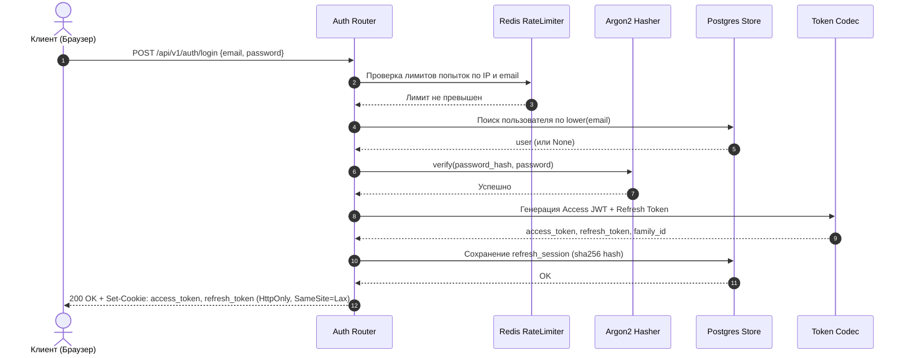

# 019-auth-sessions-and-rate-limiting: Безопасная аутентификация, сессии, Redis Rate Limiting и CLI create-admin

## Цель
Разработать и интегрировать полноценную серверную подсистему аутентификации и авторизации MedAI: криптографическое хеширование паролей Argon2id с защитой от тайминг-атак, сессионные токены JWT + Refresh Token в защищенных `HttpOnly` Cookie, хранилище сессий в PostgreSQL с ротацией семейств токенов, ограничение частоты запросов (Rate Limiting) в Redis и консольную утилиту `make create-admin`.

## Допущения и контекст
- Токены доступа (JWT Access) передаются через `HttpOnly`, `SameSite=Lax` cookie со временем жизни 15 минут (`access_ttl_seconds=900`).
- Токены обновления (Refresh Token) хранятся в БД в виде криптографического SHA-256 хэша со временем жизни 30 дней (`refresh_ttl_seconds=2592000`).
- При обнаружении повторного использования уже замененного refresh-токена компрометируется всё семейство (`family_id`), и все активные сессии пользователя аннулируются.
- Защита от перебора паролей (Brute-Force) и спам-регистраций обеспечивается через Redis (`AUTH_LOGIN_MAX_FAILURES`, `AUTH_LOGIN_MAX_PER_IP`, `AUTH_REGISTER_MAX_PER_IP`).

## Требования
- **REQ-001:** Создать модуль `backend/src/medai/auth/passwords.py` с классом `Argon2PasswordHasher`:
  - Использование алгоритма Argon2id (`time_cost=3`, `memory_cost=65536`, `parallelism=4`).
  - Выполнение в фоновом пуле потоков через `asyncio.to_thread` с ограничением конкурентности семафором `asyncio.Semaphore(4)`.
  - Защита от тайминг-атак: вычисление фиктивного хэша `dummy_hash` при обращении к несуществующему логину.
- **REQ-002:** Создать модуль `backend/src/medai/auth/tokens.py` с классом `TokenCodec`:
  - Кодирование и валидация JWT Access Token (алгоритм `HS256`, обязательные клеймы: `sub`, `role`, `jti`, `sid`, `fid`, `iat`, `exp`, `iss`).
  - Генерация криптостойких Refresh токенов (`secrets.token_urlsafe(32)`) и их хэширование по алгоритму SHA-256.
- **REQ-003:** Реализовать хранилища `PostgresUserStore` и `PostgresSessionStore` на SQLAlchemy 2.0 Core:
  - Регистрация пользователя, поиск по `lower(email)`, проверка дубликатов (`LoginTakenError`).
  - Сохранение сессий, ротация токенов, каскадный отзыв семейства (`revoke_family`).
- **REQ-004:** Реализовать `RedisRateLimiter` для отслеживания неудачных попыток входа и лимитирования запросов по IP-адресу.
- **REQ-005:** Реализовать REST API эндпоинты в `backend/src/medai/auth/router.py`:
  - `POST /api/v1/auth/register` — регистрация с установкой Cookie.
  - `POST /api/v1/auth/login` — авторизация с установкой Cookie.
  - `POST /api/v1/auth/refresh` — ротация токенов по Refresh Cookie.
  - `POST /api/v1/auth/logout` — отзыв сессии и очистка Cookie.
  - `GET /api/v1/auth/me` — получение данных текущего авторизованного пользователя.
- **REQ-006:** Реализовать интерактивную CLI-утилиту `backend/src/medai/create_admin.py` и фасадную цель `make create-admin EMAIL=<email> [ROLE=admin|superadmin]`. Пароль запрашивается безопасно через `getpass` без вывода в консоль.
- **REQ-007:** Покрыть подсистему модульными тестами с гарантией 100% прохождения.

## Сценарии взаимодействия (BDD)

### Сценарий 1: Регистрация и получение защищенных Cookie
- **Given** новый пользователь с email `ivan@medai.ru` и валидным паролем
- **When** отправляется запрос `POST /api/v1/auth/register`
- **Then** в ответе возвращается 200 OK, в заголовках `Set-Cookie` присутствуют `access_token` и `refresh_token` с флагами `HttpOnly` и `SameSite=Lax`, а в БД создана запись в `users` и `refresh_sessions`.

### Сценарий 2: Защита от тайминг-атак при неверном логине
- **Given** запрос авторизации с несуществующим email
- **When** выполняется сверка учетных данных
- **Then** выполняется верификация по `dummy_hash`, предотвращая анализ времени ответа злоумышленником, и возвращается `InvalidCredentialsError`.

### Сценарий 3: Ротация Refresh Token и обнаружение кражи
- **Given** активная сессия пользователя
- **When** клиент вызывает `POST /api/v1/auth/refresh`
- **Then** старый refresh-токен помечается замененным (`replaced_by`), выдается новая пара токенов. При повторной попытке использовать старый токен аннулируется вся цепочка `family_id`.

## Архитектура аутентификации

## Критерии приемки
- [ ] Модули `passwords.py`, `tokens.py`, `service.py`, `router.py`, `create_admin.py` реализованы и протестированы.
- [ ] Все эндпоинты `/api/v1/auth/*` отвечают согласно контракту и манипулируют Cookie.
- [ ] CLI `make create-admin` интерактивно запрашивает пароль и создает администратора.
- [ ] Все тесты проходят: `make test`.
- [ ] Линтер `ruff` проходит без замечаний: `make lint`.
- [ ] Отчет о верификации сформирован в `specs/changes/019-auth-sessions-and-rate-limiting/verification.md`.
