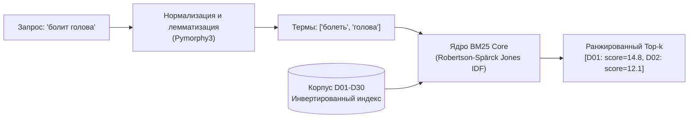

# 020-bm25-core-corpus-and-benchmark: Поисковое ядро BM25, корпус Минздрава РФ и бенчмаркинг

## Цель
Реализовать математический аппарат поисковой модели BM25 с Robertson-Spärck Jones IDF, конвейер предобработки текстов (токенизация и лемматизация Pymorphy3), сформировать официальный медицинский корпус из 30 документов (`D01`–`D30`), разработать бенчмарк-раннер для расчета метрик $MRR$, $Recall@k$ и времени отклика $P_{95}$ на контрольном датасете из 15 сценариев (включая вопросы-ловушки).

## Допущения и контекст
- В соответствии с заданием НИРС ИУ5 МГТУ им. Н. Э. Баумана (`НИРС.pdf`, разд. 1.3-1.5) сторонние поисковые движки (Elasticsearch, Whoosh, Rank-BM25) запрещены. Алгоритм BM25 реализуется с нуля на чистом Python.
- Параметры функции ранжирования: $k_1 = 1.5, b = 0.75$.
- Морфологический анализ русского языка выполняется через `pymorphy3` (OpenCorpora).
- Медицинский корпус `data/medicines/package.yaml` содержит 30 эталонных препаратов первой помощи по стандарту ГРЛС Минздрава РФ.
- Контрольный датасет `data/benchmark_queries.yaml` включает 10 естественных симптоматических запросов ($|R_{q}| \ge 3$) и 5 отрицательных вопросов-ловушек.

## Требования
- **REQ-001:** Создать модуль `backend/src/medai/rag/bm25.py` с функциями расчета Robertson-Spärck Jones IDF, функции насыщения длины и ранжирования $BM25(q, d)$ по методическим указаниям НИРС:
  $$IDF(t) = \ln \left( 1 + \frac{N - DF(t) + 0.5}{DF(t) + 0.5} \right), \quad BM25(q, d) = \sum_{t \in q} IDF(t) \cdot \frac{TF(t, d) \cdot (k_1 + 1)}{TF(t, d) + k_1 \cdot \left(1 - b + b \cdot \frac{|d|}{avgdl}\right)}$$
- **REQ-002:** Создать модуль `backend/src/medai/rag/analyzer.py` с классами `SimpleAnalyzer` и `MorphAnalyzer` (нормализация NFC, casefold, замена `ё` $\rightarrow$ `е`, регулярное выражение токенизации `[a-zа-я0-9]+(?:-[a-zа-я0-9]+)*` с сохранением дефисных названий, приведение к нормальной форме через `pymorphy3`).
- **REQ-003:** Реализовать инвертированный индекс `InMemoryBm25Index` в `backend/src/medai/rag/index.py` и модуль сохранения в БД `backend/src/medai/rag/postgres.py`.
- **REQ-004:** Сформировать пакет медицинских знаний `data/medicines/package.yaml` на 30 документов (`D01`–`D30`) с обязательными полями: `id`, `title`, `inn`, `atc_code`, `category`, `forms`, `indications`, `contraindications`, `dosage`, `interactions`, `emergency_flags`.
- **REQ-005:** Сформировать контрольный набор запросов `data/benchmark_queries.yaml` (10 симптоматических с $|R_{q_i}| \ge 3$, 5 ловушек без релевантных документов).
- **REQ-006:** Создать модуль бенчмаркинга `backend/src/medai/rag/benchmark.py` с расчетом метрик $MRR$, $Recall@1$, $Recall@3$, $Recall@5$, Correct Rejection Rate и $P_{95}$ latency.
- **REQ-007:** Добавить CLI-команды `make knowledge-load DIR=<path>` и `make bench` в [Makefile](Makefile).
- **REQ-008:** Добиться выполнения целевых академических критериев MedAI: $MRR \ge 0.80$, $Recall@3 \ge 0.85$, $Recall@5 \ge 0.92$, Correct Rejection Rate $= 1.00$, $P_{95} \le 15\text{ мс}$.

## Сценарии взаимодействия (BDD)

### Сценарий 1: Точный поиск препаратов по симптоматическому запросу
- **Given** проиндексированный корпус из 30 медицинских документов
- **When** пользователь или агент запрашивает: *"Сильная головная боль, ломит виски"*
- **Then** в top-3 выдаче возвращаются релевантные анальгетики (`D01` Ибупрофен, `D02` Парацетамол, `D03` Пенталгин), $MRR = 1.0$, $Recall@3 \ge 0.85$.

### Сценарий 2: Отработка вопроса-ловушки (Trap Query)
- **Given** вопрос-ловушка о заболевании или препарате, отсутствующем в домашней аптечке (например, *"тропическая малярия"*)
- **When** выполняется поиск BM25 и анализ контекста
- **Then** система возвращает маркер отказа (*"в документах нет этой информации"*), галлюцинация предотвращена, Rejection Rate $= 1.00$.

## Архитектура поискового конвейера

## Критерии приемки
- [ ] Все 30 документов `D01`–`D30` валидируются схемой Pydantic v2.
- [ ] Все 15 вопросов `benchmark_queries.yaml` валидируются схемой `BenchmarkSet`.
- [ ] Запуск `make bench` рассчитывает метрики и выводит сводную таблицу в консоль.
- [ ] Целевые показатели достигнуты ($MRR \ge 0.80$, $Recall@3 \ge 0.85$, $Recall@5 \ge 0.92$, Rejection Rate $= 1.00$).
- [ ] Все тесты `make test` и проверка `make lint` пройдены без ошибок.
- [ ] Отчет о верификации зафиксирован в `specs/changes/020-bm25-core-corpus-and-benchmark/verification.md`.
