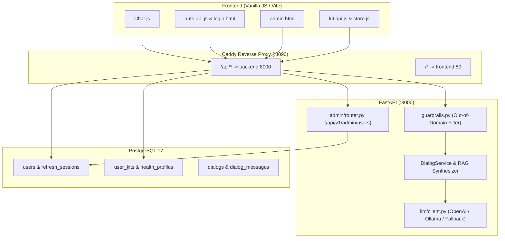

# План реализации: 023-robust-chat-auth-and-llm-integration

## Архитектура решения

## Пошаговый план изменений

1. **Регистрация спецификации:**
   - Зарегистрировать `023-robust-chat-auth-and-llm-integration` в `specs/status.yaml` скриптом `spec_status.py`.

2. **Бэкенд:**
   - Создать `backend/src/medai/dialogs/guardrails.py` с проверкой `is_medical_query(text) -> bool` и формированием отказа `OUT_OF_DOMAIN_RESPONSE`.
   - Обновить `backend/src/medai/dialogs/service.py`:
     - Поддержка обогащения контекста при передаче выбранных лекарств или вопросов вида «что это».
     - Интеграция `medai/llm/client.py` для генерации ответов через LLM (OpenAI-compatible) при наличии ключа или локальный синтез.
   - Создать эндпоинт `GET /api/v1/admin/users` в `backend/src/medai/auth/admin_router.py` (или расширить `auth/router.py`), возвращающий список пользователей для администраторов.

3. **Фронтенд — Сеть и Аутентификация:**
   - В `frontend/src/api/client.js` установить `API_BASE = '/api/v1'`, передавать `credentials: 'include'`.
   - В `frontend/src/api/auth.api.js` и `frontend/login.html`:
     - Убрать зависимость от `res.token` в теле JSON; при статусе 200/201 сохранять `res.user || res`.
     - Добавить `authApi.getMe()` для вызова `GET /api/v1/auth/me`.
   - В `frontend/src/app.js`: при загрузке проверять сессию через `authApi.getMe()`.

4. **Фронтенд — Чат и Чистый профиль:**
   - В `frontend/src/components/Chat.js`:
     - Сделать рендеринг устойчивым: если `msg.data.recommendation` отсутствует, отображать текстовый ответ ассистента `msg.data.text` или `msg.text`.
     - Завернуть вызов `sendQuery` в `try ... finally` для разблокировки `chatSendBtn` и сброса маскота.
     - Передавать `selectedPills` в запросе к `chatApi`.
   - В `frontend/src/api/kit.api.js`: убрать `DEFAULT_KIT`, стартовать с `[]`.
   - В `frontend/src/state/store.js`: инициализировать медкарту пустыми массивами `{ allergies: [], chronic: [] }`.
   - В `frontend/admin.html`: связать таблицу пользователей с `GET /api/v1/admin/users`.

5. **Тестирование и верификация:**
   - Написать тесты для guardrails, admin users API и контекста аптечки.
   - Прогнать `make lint` и `make test`.
   - Зафиксировать результаты в `verification.md` и перевести спецификацию в статус `done`.
